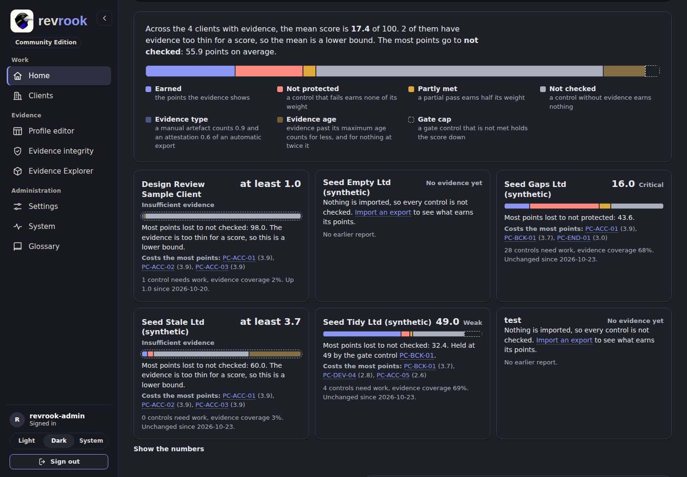
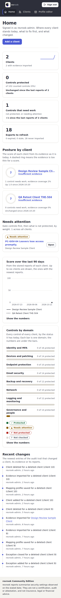
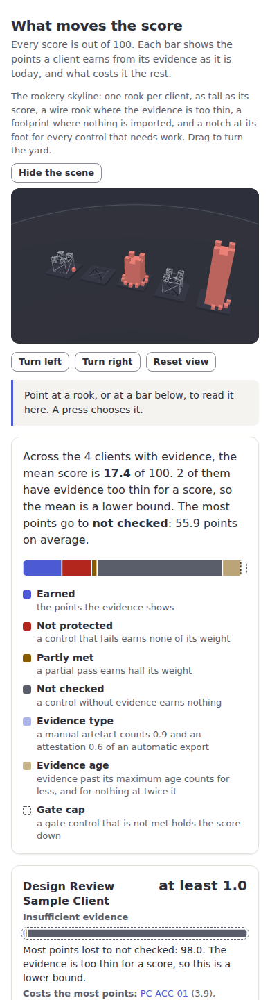

# revrook-ce

Revrook Community Edition (CE): self-hosted client security posture, insurance evidence and QBR reporting for small MSPs.

Licensed under the [MIT licence](LICENSE).

## Status

Pre-release. This repository is in Development only. There is no released version, no hosted service and no supported installation yet. Nothing here should be read as a claim of customers, certification or availability.

## What this repository is

This is the Community Edition (CE) and nothing else. Every file in it is under the MIT licence, it runs on your own machine with no licence key, no outside account and no paid service, and it holds no code and no names that belong to a later or paid edition. What an installation adds goes in through the documented extension API (version 1, [docs/extension-api.md](docs/extension-api.md)).

You export evidence from the tools you already use (device, backup, network, training, leaver, mail and Microsoft 365 exports) and upload it. Revrook checks it against 51 plain-language controls, scores the result with a lower and an upper bound, and makes a quarterly security review and a cyber insurance evidence pack for each client, each as one HTML file.

The Community Edition has one account: the administrator, created on the first-run page the first time a new installation is opened. There is no user management in CE (no further accounts, roles or invitations); this is by design, not a gap.

## What the output is

Revrook produces a configuration evidence summary. It is not a certification, audit or legal advice. Every evidence item shows its evidence date, and every score shows the ruleset version used to produce it.

**Scores are uncalibrated design choices.** The weights, thresholds and bands of the ruleset are our own written-down judgement. They have not been calibrated against real incidents, insurers or auditors. Read a score to compare a client with its own earlier state and to see what to fix first, not as a measurement.

**Mappings to outside frameworks are unverified unless marked.** Controls carry pointers to NIST CSF 2.0, NIST SP 800-171, CIS Controls, ISO/IEC 27001, Cyber Essentials and NIS2 identifiers. No row has been verified yet, and a report prints an outside identifier only for a row that a person has marked verified, so today it prints none ([docs/mapping-verification.md](docs/mapping-verification.md)).

## Try it

The [quick start](docs/quick-start.md) takes you from nothing to an exported quarterly review in about ten minutes, with invented demo data: start the stack with `docker compose up --build --wait`, make the first account, then run `bash scripts/demo.sh YOUR-USER-NAME`.

## What it looks like

Live captures of the Development site, taken on 2026-10-27 and 2026-10-28 from the
application build documented and captured (commit
`d0a2e9fe8c769bb3fdb8ee884a3c16199dcc57a5`, image
`sha256:91c6b72cb44ddd4aba33b1c04c0b2b27283311ebab5f752eba92faa5b67183ef`; the six
pictures changed by the layout fixes on top, commit
`f6fc70857e776629e13edb04e75a353bee6682fe`, image
`sha256:49ab77bf0718d3ee37cb477da54a1a1fd5ea9d2ceedd51fc406f952351e6045a`, were taken
again on that build, and the four that show chosen rows were taken again on the fix of
their links, commit `ab870e4dd8af940747344544be459f84d773227e`, image
`sha256:2b49e1635a8ebaccd629c65be3bf0ebc59ac20b9b954844626a178379deedf1b`), with
synthetic test data only
([capture manifest](docs/images/README.md)). Later documentation-only
commits are deployed on top with the same application code; the deployed head is read
from the deployment receipt and the package manifest.

**Home**: the keep, the charcoal band with the battlement of the mark, carries the title
and the one primary action; the four stat cards stand on its foot as one ledger; under
**What moves the score** the gauge of the mean score sits beside the rookery skyline,
one rook per client as tall as its score
([guide 2](docs/guides/02-clients-and-home.md),
[guide 8](docs/guides/08-scenes-rail-and-explorer.md)).

**What moves the score**: the hundred points of each client split into what it earns
and what costs it the rest, with the controls that cost the most
([guide 2](docs/guides/02-clients-and-home.md#what-moves-the-score)).

**A client overview**: the domain keep in the coverage card, one block per domain built
of its controls by status, with a domain chosen from the keyboard; the bars under it
carry the same facts.

**Clients**: the filters in use as chips and the bulk actions, with three clients
chosen ([guide 9](docs/guides/09-top-bar-filters-and-bulk-actions.md)).

**Evidence Explorer**: which evidence exports feed which controls of one client.

### On a phone

The same pages at 390 px: the navigation is a strip under the brand that scrolls
sideways, with a cue at its edge, and every card and table row takes the whole width
([guide 2](docs/guides/02-clients-and-home.md)).

## Documentation

| Page | What it holds |
| --- | --- |
| [docs/quick-start.md](docs/quick-start.md) | From nothing to an exported quarterly review, with demo data |
| [docs/install.md](docs/install.md) | Running it for real: keys, compose, TLS and a checklist |
| [docs/configuration.md](docs/configuration.md) | Every environment variable with its default |
| [docs/upgrade.md](docs/upgrade.md) | Moving to a newer version, and going back |
| [docs/operations.md](docs/operations.md) | Worker, reminders, retention, limits, metrics, backup and restore |
| [docs/security.md](docs/security.md) | Sign-in and security design |
| [docs/security-review.md](docs/security-review.md) | The security checklist of phase 11 and its findings |
| [docs/controls.md](docs/controls.md) | The control library and the check engine |
| [docs/scoring.md](docs/scoring.md) | The scoring decisions and the sensitivity result |
| [docs/scoring-engine.md](docs/scoring-engine.md) | The scoring engine and snapshots |
| [docs/importers.md](docs/importers.md) | How each source is exported and imported |
| [docs/dns-check.md](docs/dns-check.md) | The public SPF, DKIM and DMARC check |
| [docs/reports.md](docs/reports.md) | The two reports and their export |
| [docs/mapping-verification.md](docs/mapping-verification.md) | Mapping policy, source versions and the register of verified rows |
| [docs/extension-api.md](docs/extension-api.md) | Extension API version 1 |
| [docs/licences.md](docs/licences.md) | Licences of the dependencies |
| [docs/development.md](docs/development.md) | Development guide |
| [docs/design-system.md](docs/design-system.md) | Tokens, shell and components of the web interface |
| [docs/evidence-explorer-preview.md](docs/evidence-explorer-preview.md) | The Evidence Explorer, the scene of one client's evidence sources and the controls they feed |
| [docs/testing.md](docs/testing.md) | Testing notes |
| [docs/ci-cd.md](docs/ci-cd.md) | CI/CD flow and known gaps |
| [docs/pdf-spike.md](docs/pdf-spike.md) | The PDF spike and why the reports are HTML |
| [docs/release-candidate.md](docs/release-candidate.md) | Acceptance state and the release workflow check |
| [docs/release-notes.md](docs/release-notes.md) | The release candidate, what it holds and its known limits |
| [docs/guides/README.md](docs/guides/README.md) | Step-by-step guides for every flow, including the scenes, the folded rail, the Evidence Explorer, the top bar, the checklist tools, the score drivers and the bulk actions, with live screenshots ([docs/images](docs/images/README.md)) |

Changes are listed in the [CHANGELOG](CHANGELOG.md).

## Known limits

The release candidate keeps these limits in the open ([docs/release-notes.md](docs/release-notes.md)): the 321 mapping rows to outside frameworks are unverified, so no report prints an outside identifier; there is no importer for the controls PC-END-03 and PC-END-05, which stay Not checked; there is no PDF export, the reports are HTML files with print styles; the copyright holder named in the MIT licence is still an open decision; and branch protection on the repository has not been set.

## Contributing and security

- Contribution rules: [CONTRIBUTING.md](CONTRIBUTING.md)
- Reporting a vulnerability: [SECURITY.md](SECURITY.md)
- CI/CD flow and known gaps: [docs/ci-cd.md](docs/ci-cd.md)

## Running it

- Install and first start: [docs/install.md](docs/install.md)
- Worker, reminders, retention, metrics, backup and restore: [docs/operations.md](docs/operations.md)
