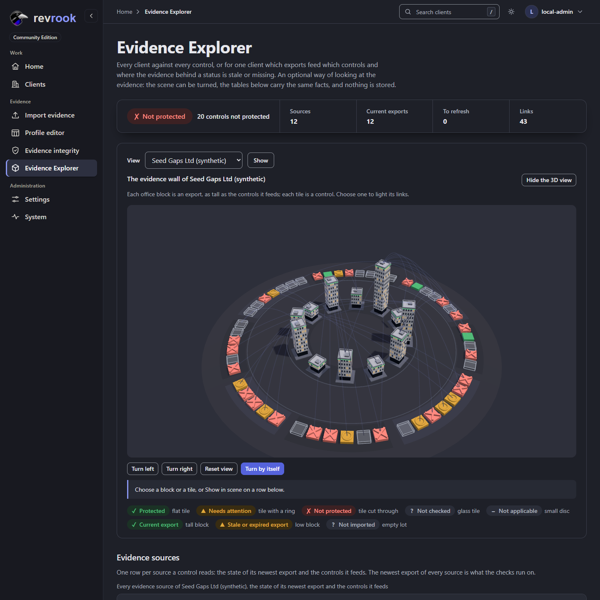

# Evidence Explorer

A page at `/experiments/evidence-explorer`, in the rail (Evidence, after Evidence
integrity), in two views. Without a client it is the **companies ring**: every active
client against every control. With `?client_id=N` (the link "Open in Evidence Explorer
(preview)" of a client's evidence page, and the **View** chooser at the top of the
scene card) it is the **evidence wall** of that client: which evidence exports feed
which controls, and where the evidence behind a status is stale or missing. A link
made before the companies ring, with a client, opens exactly what it did; the page
without one used to show the first client and now shows the ring. It began as an
experiment on the
Development installation to judge a scene drawn in the browser; after the founder
saw it, the same direction was taken to Home and the client overview
([design-system.md](design-system.md), Scenes), and the page is now an optional view
of the interface. It is not part of any report, it stores nothing, and it loads
nothing from outside the installation. The address keeps its first form so that no
link or bookmark breaks.

A step-by-step tour, with pictures at 1440, 768 and 390 px in both themes, is in
[guide 8](guides/08-scenes-rail-and-explorer.md#the-evidence-explorer).

## The companies ring

The page without a client reads every active client the way Home does
(`read_clients` in `app/ui/home.py`, shared by both pages: one live evaluation per
client, `load_live` then `view_of`, and nothing more), and `build_portfolio` in
`app/ui/explorer_view.py` turns the control rows of every client into the ring:

- an office per client on the inner ring, as on Home's street: as tall as its score,
  as wide as the company, its roof light the band, in scaffolding when the evidence is
  too thin, an empty lot with none. The ring grows with the clients and every office
  narrows alike when it is crowded;
- every control of the library (51) on the outer ring, grouped by domain like the
  wall, a tile in the worst status any client has for it (not protected, needs
  attention, not checked, protected; not applicable only when it is so everywhere),
  in the shapes of the wall;
- a link from every client to every control, coloured by the status of that pair; a
  pair that is not applicable has none.

Four filter buttons under the stage (`aria-pressed`, one per status, with the number
of its links) show or hide each kind of link: not protected and needs attention show
at first, protected and not checked are hidden, so the ring reads at a glance. Links
are faint until a node is chosen; choosing an office lights its shown links and the
tiles at their ends and opens the company card of Home (`_company_card.html`);
choosing a tile lights its links and opens a card that lists every client with its
status for that control, worst first, each a link to that control of that client that
opens in the control drawer of the page (`_drawer.html` is on the page, so
`data-drawer` works as on Home). On the canvas, Left and Right step through the
clients and then the controls, Enter opens the chosen client or the control of the
first client on the tile's card, Escape closes the card, the brackets turn the ring;
Turn left, Turn right, Reset view and Turn by itself work as on the wall, and so does
reduced motion. Below 600 px of stage width the card stands under the stage.

Under the scene, **Companies** (each client with its score and band and how many of its
controls stand at each status, and **Show in scene**) and **Controls across the
companies** (each control with its domain and how many clients stand at each status)
are the record. Clients that cannot be read today are listed above the card, as on
Home.

Why the ring has no JSON: its tables and cards are drawn by the server anyway, from
the same rows the scene needs, so `evidence-explorer.js` reads the scene from the page
(the rows of the two tables and the client lists of the control cards), the way
`scenes.js` reads Home. A JSON route would have evaluated every client a second time
for each view of the page.

## The evidence wall of one client

The wall reads a client exactly as its checklist and its evidence page do: the
newest export of every source, run through the check engine (`app/posture.py`), and
the state of each export (`app/ui/viewmodels.py`, `source_rows`). A control is
linked to a source when its rule reads a column of that source's adapter
(`field_map` in `data/controls.yaml`); a manual-only control reads no export and has
no link. `app/ui/explorer_view.py` turns the two into one view model, and
`app/ui/explorer.py` serves it twice from the same object:

- as the page: a verdict band, the scene, and two tables (the sources with the
  state of their newest export and the controls they feed; the controls with their
  status today, their evidence and the exports they read);
- as JSON at `/experiments/evidence-explorer/data?client_id=N`, for the scene (without
  `client_id` the JSON is that of the first client by name).

The tables are the record. The scene is one way of looking at them, and it starts
hidden: the card opens with **Show the 3D view** in its head, and the wall is drawn
(and the library loaded) only once a person presses it, the same choice the scenes of
Home and the client overview keep in this browser. The public DNS check counts as a
source of the three mail controls, so it stands as a pillar of its own.

## The scene: the evidence wall

An inner ring of pillars, one per evidence source, each as tall as the number of
controls it feeds and crenellated like a rook; a current export is a full pillar in
the brand stone, a stale or expired one a low pillar in the status colour, a source
never imported only a footprint. An outer ring of tiles, one per control, grouped
by domain around the wall: a flat tile for Protected, a tile with a ring for Needs
attention, a tile cut through for Not protected, an outlined tile for Not checked,
a small disc for Not applicable. A beam joins a source to every control that reads
it. Status is shape and colour together, never colour alone, and nothing is written
inside the scene: the detail line, the legend and the tables carry every word.

Hovering over a pillar or a tile names it; selecting it brings its beams
forward while the rest steps back; the same happens from the **Show in scene**
button of a table row, which also turns the wall to face it. A drag turns and tilts
the wall; the buttons under it turn it by a step or reset the view. The canvas is
announced as an application (a scene), so a screen reader passes its keys on; with
it focused, Left and Right turn, plus and minus move closer and away, Home resets,
Escape clears the selection. The home view of both views is fitted to the stage: the
nearest distance at which the outer corners of the tiles and the roofs of the inner
ring stay inside the view, measured again when the stage changes shape. The ground is the brand charcoal in both themes, the
same dark surface as the rail; the colours on it are the dark-theme status values of
`revrook.css`, which reach 4.5 to 1 on it.

## How it is built, and what it does without

- `app/static/js/evidence-explorer.js` is an ES module loaded by this page alone,
  under the same content security policy as every page (`default-src 'self'`, no
  inline script, no `unsafe-eval`). It checks for WebGL 2 first and only then
  imports the library, so a browser without WebGL 2 never downloads it.
- three.js r186 (npm `three@0.186.1`, MIT) is served unmodified from
  `app/static/vendor/three`: `three.module.js` and `three.core.js` as published.
  The licence file and `PINNED.json` are committed; the two build files are not.
  `PINNED.json` records the npm tarball integrity and the SHA-256 of each file, and
  `tools/fetch_three.py` downloads that tarball, checks it and writes the two files
  only when every check passes. CI runs it before the tests and the image build runs
  it in the builder stage. To run the tests on your machine, run
  `python tools/fetch_three.py` once first; `tests/test_evidence_explorer.py` checks
  the files against `PINNED.json`. The two files are 2.1 MB (about 420 KB
  compressed); a smaller tree-shaken build needs a bundler the repository does not
  have and is a decision for later. No CDN, no download by the browser or at run
  time, no automatic update.
- Without script, or without WebGL 2, the stage keeps a note rendered by the server
  and the tables are the page. A request that fails (a session that ended, a client
  that is gone) leaves a note that says what to do. A lost graphics context stops
  the drawing with a note and resumes when the browser restores it.
- `prefers-reduced-motion` stops the wall turning by itself and makes every move
  immediate, also when the setting changes while the page is open; otherwise it
  turns slowly until the person touches it. Frames are drawn only when something
  changed or the wall is turning, never while the page is hidden or the stage is
  out of view.
- Leaving the page disposes every geometry, material and the renderer.
  `document.getElementById("explorer").revrookExplorer` offers `dispose()`,
  `mount()` and `info()` so a test can cycle the scene ten times and read the
  renderer's geometry and program counts.

## Limits

The scene has been checked in a headless browser with a software renderer
(SwiftShader) on the Development site; no hardware GPU, WebGPU, phone or touch
screen has been measured. The 51 controls and up to 13 sources of a client are a
small scene. The companies ring draws one line per pair (51 per client); it was
checked with a handful of clients, and a portfolio of hundreds would want the links
merged per status. The page keeps its own script (`evidence-explorer.js`) while the
rookery skyline and the domain keep share `scenes.js`; they share the office model
(`office.js`) and the card (`scene-card.js`).
