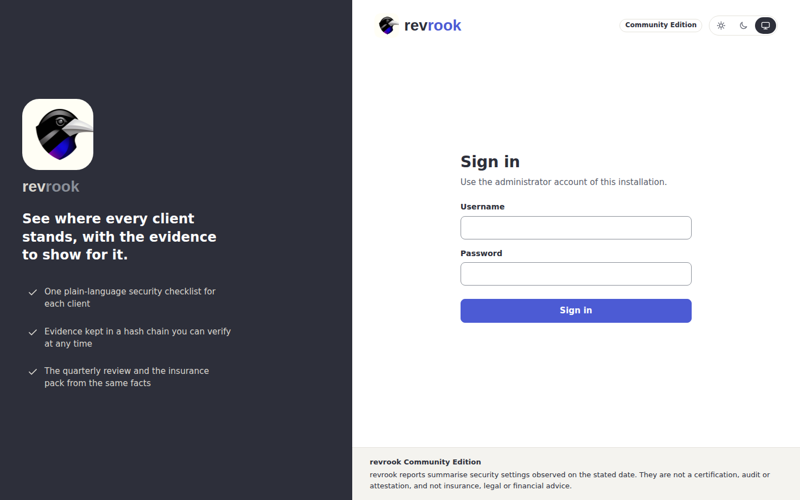
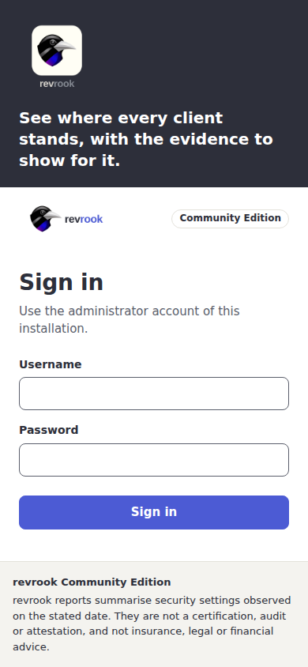
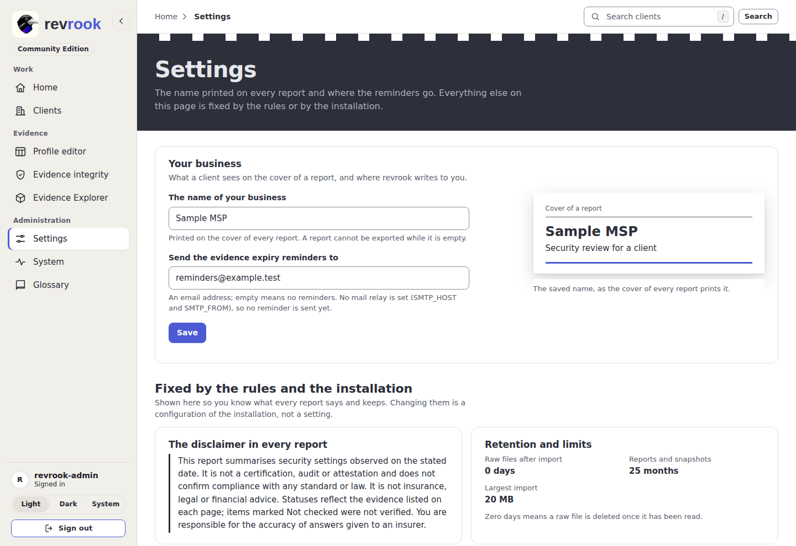

# 1. First start and sign-in

What you need: a running installation ([install](../install.md) or the
[quick start](../quick-start.md)) and its address. The Community Edition has exactly
one account, the administrator; there is no user management, no invitation and no
second role.

## Create the administrator (first start only)

1. Open the address of the installation. A new installation sends you to the first-run
   page, **Create the administrator**.
2. Choose a username and a password of 12 to 256 characters, repeat the password and
   press **Create administrator**.
3. The page works only until the first account exists: afterwards `/setup` sends you
   to the sign-in page. Whoever reaches a new installation first can claim it, so do
   this before the installation is reachable by others ([security](../security.md)).

The first-run page is not pictured: the Development site already has its account, so
the page cannot be shown there without re-installing it.

## Sign in

1. Open the address. Signed out, you see the sign-in page: the charcoal panel with the
   logo on the left and the form on the right (one band above the form on a phone).
2. Type the username and the password and press **Sign in**.

Five failed sign-ins lock the account for five minutes; while it is locked the password
is not checked. The session is a signed cookie that lasts 12 hours and slides with use.

## Set the name of your business

1. Open **Settings** in the Administration group of the navigation rail.
2. Under **Your business**, type **The name of your business** and press **Save**. It
   is printed on the cover of every report, and a report cannot be exported while it is
   empty.
3. The reminder address on the same card is where the evidence expiry reminders go,
   once a mail relay is set in the environment of the worker
   ([operations](../operations.md#expiry-reminders)).

## Sign out

Press **Sign out** under your name at the bottom of the rail (at the right end of the
bar on a narrow screen). Sign-out clears the cookie and issues a new CSRF token.

Next: [2. Home and clients](02-clients-and-home.md).
