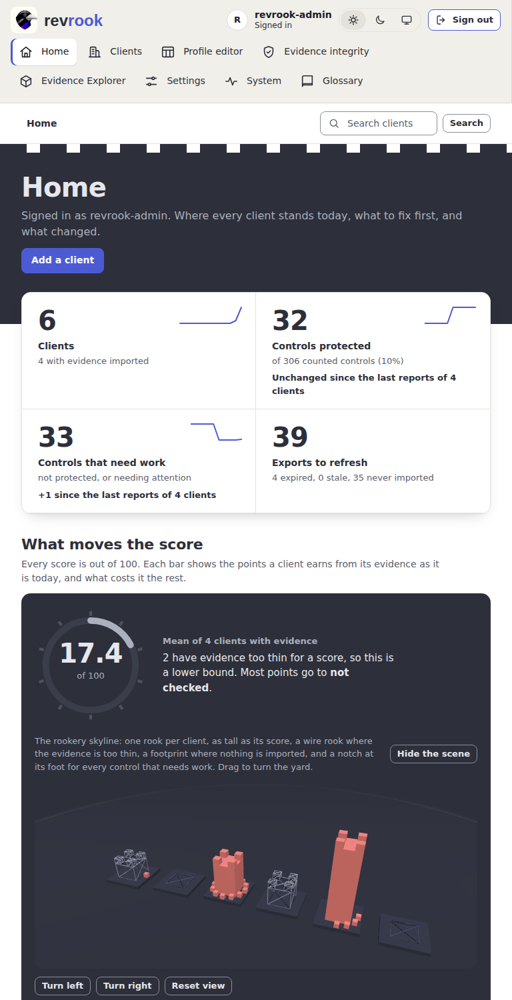
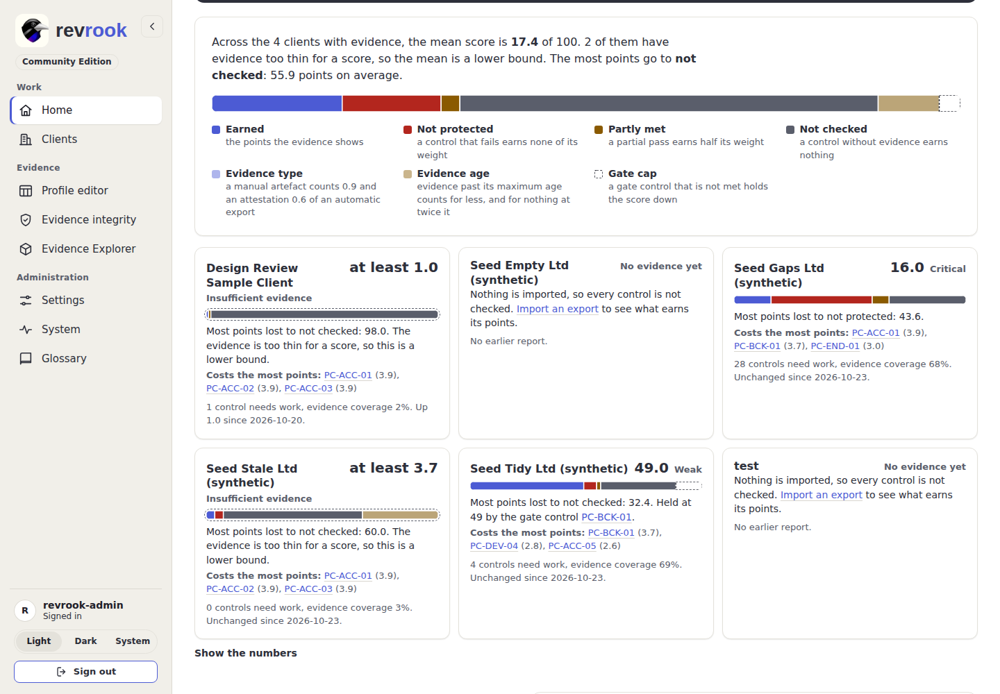
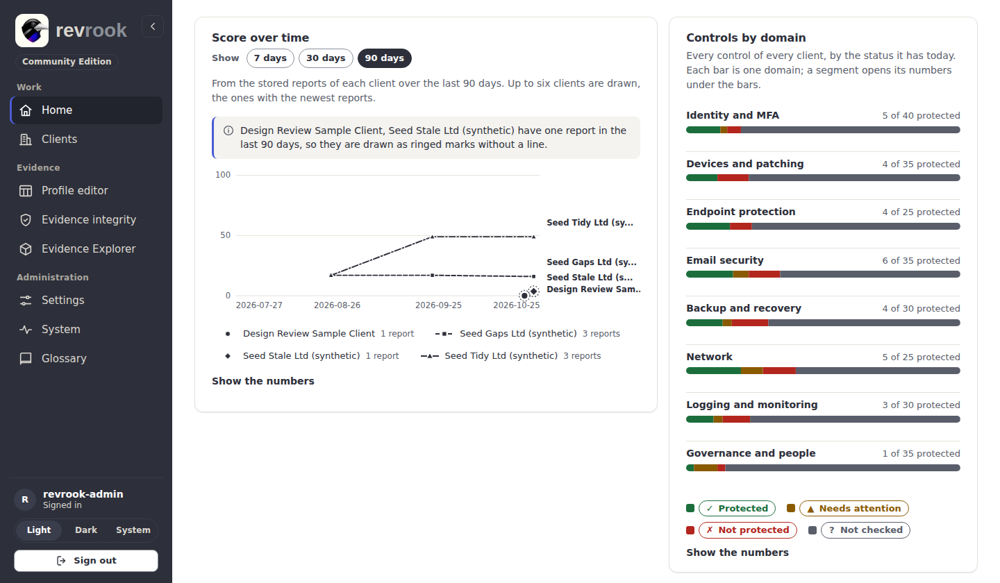
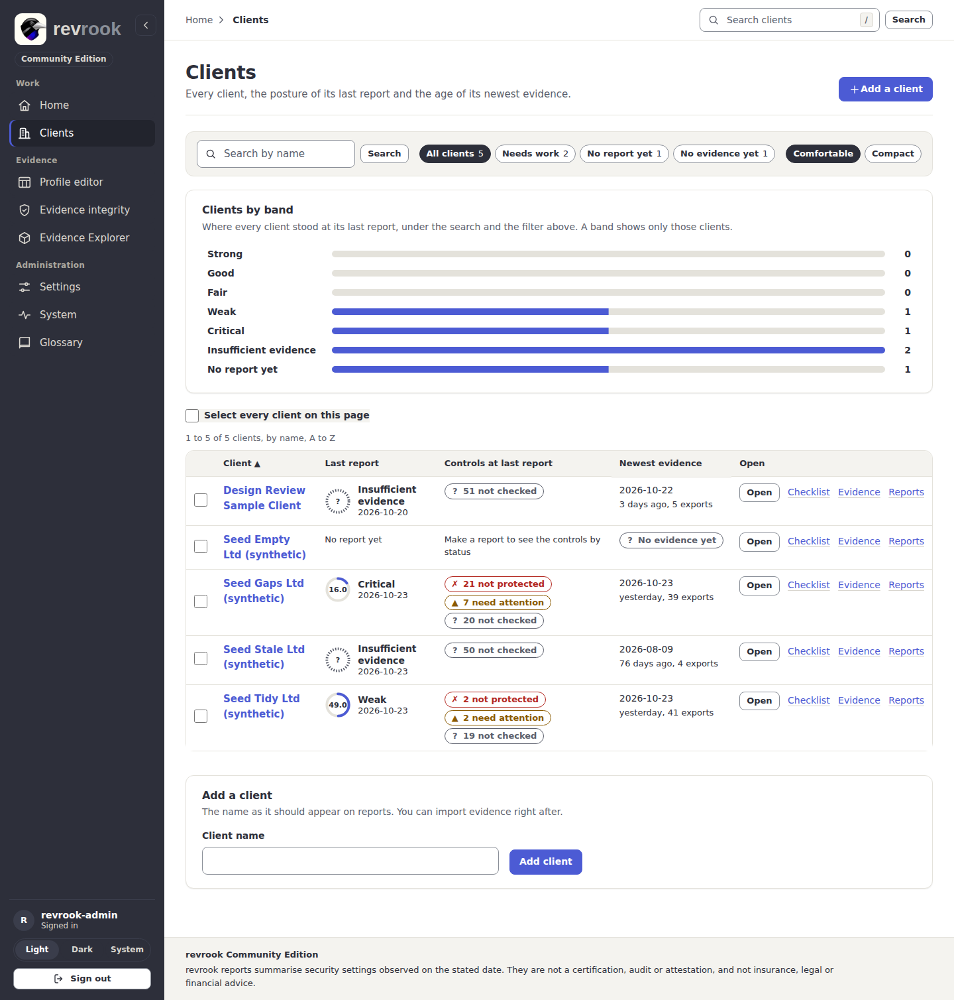
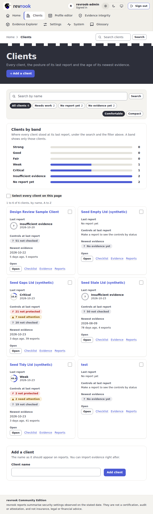
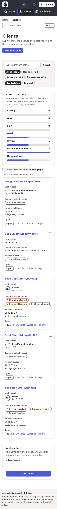
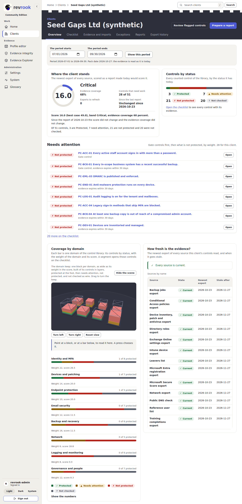

# 2. Home and clients

## Home: where every client stands

Signed in, you land on **Home**. It is read from the same stored reports and snapshots
as the client pages; nothing on it is a check run on the fly.

Every signed-in page opens with the top bar: the breadcrumb of the page on the left and
**Search clients** on the right, which the **/** key reaches from anywhere outside a
field ([9. The top bar, the filters in use and bulk actions](09-top-bar-filters-and-bulk-actions.md#the-top-bar)).
Under it the keep, a charcoal band whose top edge is the battlement of the revrook mark,
carries the title of the page, its purpose and its one primary action (on Home, **Add a
client**); on a client page it also carries the tabs of the client.

From top to bottom:

1. Four stat cards in one ledger standing on the foot of the band: clients, controls
   protected, controls that need work and exports to refresh, each with the change
   since the last reports and a sparkline of its weeks.
2. **What moves the score**: a keep panel with the gauge of the mean score of every
   client with evidence (in the quiet colour, and called a lower bound, when it counts
   a client whose evidence is too thin) beside the rookery skyline, one rook per client
   as tall as its score ([8. Scenes, the folded rail and the Evidence Explorer](08-scenes-rail-and-explorer.md)),
   then the score drivers described below.
3. **Needs attention**: the gate controls first, then what is not protected, by weight,
   across all clients. **Open** shows the control in a drawer over the page
   ([4. The checklist](04-checklist-and-control-notes.md#the-drawer-and-the-page-of-a-control)).
   A client with an open exception for that control says so on the row.
4. **Score over time** from the stored reports of the last 7, 30 or 90 days, beside
   Needs attention from 1280 px. **Show the numbers** opens the table behind the chart.
   Point at a mark, or reach it with Tab and the arrow keys, for its exact values; a
   mark opens that report. The name of each client stands at the end of its line, tied
   to it by a short leader when names are moved apart so they do not overlap.
5. **Controls by domain** as one bar per domain, beside **Recent changes** from 1280 px:
   the newest entries of the audit trail that changed a client, its evidence or its
   reports, with who made each change. A deleted client is named by its number. This
   row is not pictured: on the shared Development installation Recent changes names a
   seeded sign-in account (see the [capture manifest](../images/README.md)).

The picture above is the page at 1440 px wide down to Needs attention and Score over
time. On a tablet the navigation wraps on two rows at the top and the cards stand two to
a row; on a phone they stand one to a row and the navigation is a strip that scrolls
sideways, with a chevron at its edge while more links lie beyond it.

## What moves the score

Every score is out of a hundred. The score drivers split those hundred points of each
client into what it earns and what costs it the rest, with the arithmetic of the
scoring engine, so the parts add up to a hundred exactly and nothing is estimated.

1. **The summary** gives the mean score over the clients with evidence and names the
   driver that costs the most points on average. When it counts a client whose evidence
   is too thin for a score, it says that the mean is a lower bound.
2. **The bar and its legend**: **Earned** (the points the evidence shows), **Not
   protected**, **Partly met** and **Not checked** (a status), **Evidence type** (a
   manual artefact or an attestation counts for less than an automatic export),
   **Evidence age** (evidence past its maximum age counts for less) and **Gate cap** (a
   gate control that is not met holds the score down). Solid fills are a status,
   lighter fills the evidence and a dashed box the gate cap, so no driver is told by
   its colour alone.
3. **One card per client**: the name, the score and the band, its bar, the driver that
   costs it the most in words, the gate control that holds the score, and the three
   controls that cost the most points, each opening the control drawer. A client whose
   evidence is too thin has a dashed outline round its bar and **at least** before its
   score; a client without evidence has no bar and a link to import an export.
4. **Show the numbers** holds every point of every client in a table.

## Score over time with few reports

A line joins two stored reports or more of the same client; nothing is drawn that is
not stored. When a range holds few reports, the chart says so instead of drawing an
empty plot:

- Each client keeps its own mark shape (circle, square, diamond and so on) and dash,
  and the legend counts the reports of each client in the range.
- A client with one report in the range is one larger mark in a dashed ring, and a note
  above the drawing names it ("... have one report in the last 90 days, so they are
  drawn as ringed marks without a line"). With one report per client the note says
  there is no line yet and invites the 90-day range.
- A line that enters from a report before the range starts at the left edge with no
  mark there, and the note names that report and its date.
- Switching every client off in the legend says so and how to bring a line back.

## Clients: the list

Open **Clients** in the Work group. Every client shows the posture of its last report,
the controls at that report as pills with counts, the newest evidence with its age, and
the links **Open**, **Checklist**, **Evidence** and **Reports**.

- **Clients by band** counts the clients in each band of their last report; a band
  narrows the list to those clients.
- **Search by name** and the chips **All clients**, **Needs work**, **No report yet** and
  **No evidence yet** filter the list; the headings sort it; **Comfortable** and
  **Compact** change the density. Fifty clients make a page.
- Every filter in use is a chip under **Filtered by**; press its cross to remove it, or
  **Clear all filters**.
- With script, a select box on every row chooses clients for **Make reports**,
  **Download as CSV** and **Delete** in a bar at the foot of the window
  ([9. Bulk actions](09-top-bar-filters-and-bulk-actions.md#bulk-actions-on-the-clients-list)).
- Below 1024 px the rows are cards, two to a row from 768 px and one on a phone.

## Add a client

1. Press **Add a client** at the top of the list, or use the card at its bottom.
2. Type the **Client name** as it should appear on reports and press **Add client**.
3. The client opens on its overview, ready for its first import
   ([3. Import evidence](03-import-evidence.md)).

## The overview of a client

The overview opens on the keep: the name of the client under the link back to
**Clients**, the two actions **Review flagged controls** and **Prepare a report**, and
the tabs **Overview**, **Checklist**, **Evidence and imports**, **Exceptions**,
**Reports** and **Export history** at the foot of the band. On a phone the tabs are a
strip that scrolls sideways, with a chevron at its edge while more tabs lie beyond it.

- The period picker at the top chooses the quarter a report would cover; **Show this
  period** reloads the page for it. The evidence is always read as it is today.
- **Where the client stands** is the posture ring with the band, the coverage, the
  exports to refresh and the change since the last report, with the summary sentence
  the report would print.
- **Controls by status** is the bar and the four pills; **Open the checklist** leads to
  every control with its evidence.
- **Needs attention** lists the controls to fix first for this client.
- **Coverage by domain** holds the domain keep, one block per domain as wide as its
  weight in the score and built of its controls in layers by status, above one bar per
  domain with its weight and score. A segment of a bar opens the checklist narrowed to
  that domain and status ([8. Scenes](08-scenes-rail-and-explorer.md#the-domain-keep-on-a-client-overview)).
- **How fresh is the evidence?** names the sources that need a fresh export and lists
  every source with its newest export and the date it goes stale.
- **Recent changes** is the audit trail of this client (not pictured, for the reason
  given under Home).

Next: [3. Import evidence](03-import-evidence.md).
