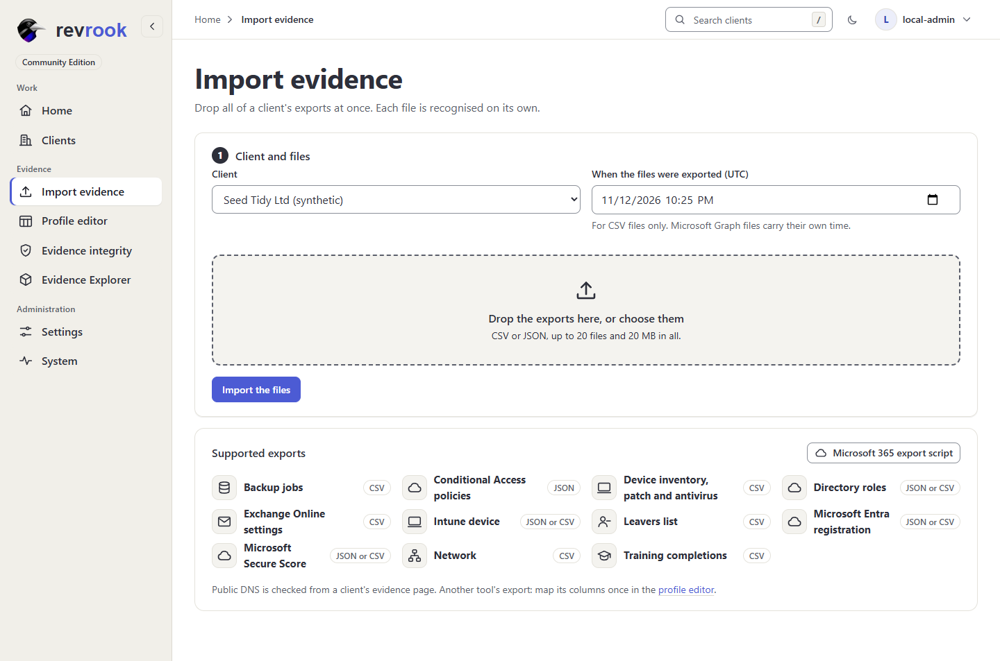
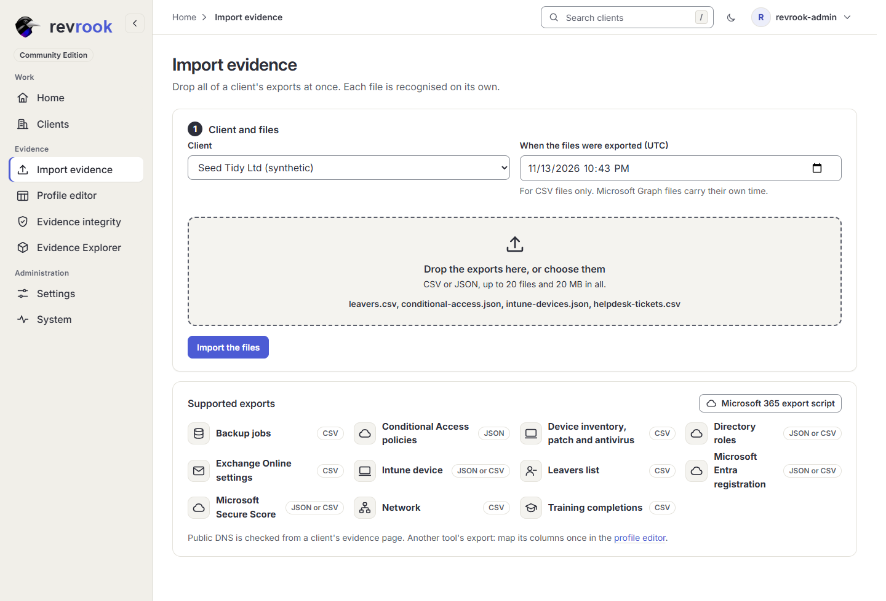
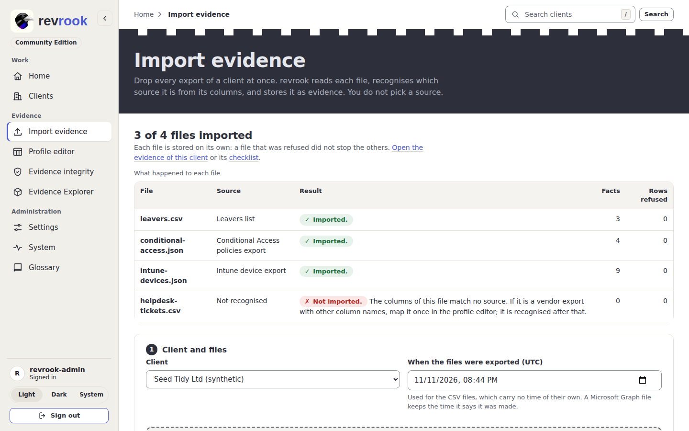
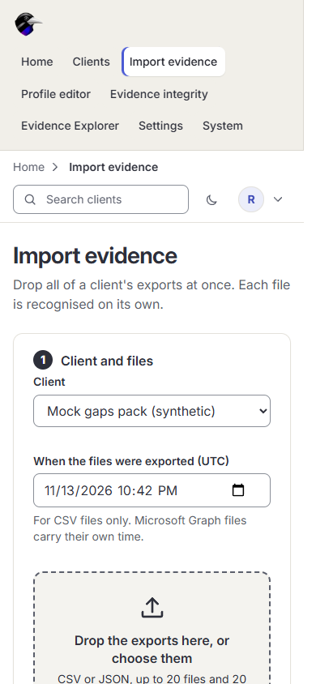
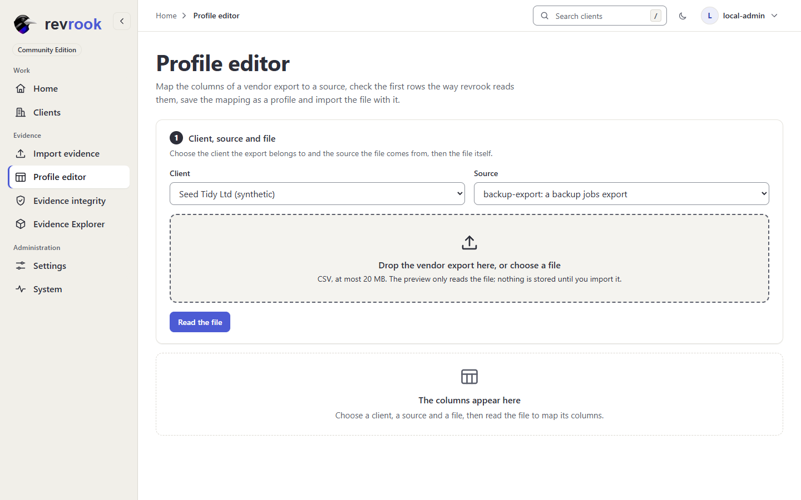
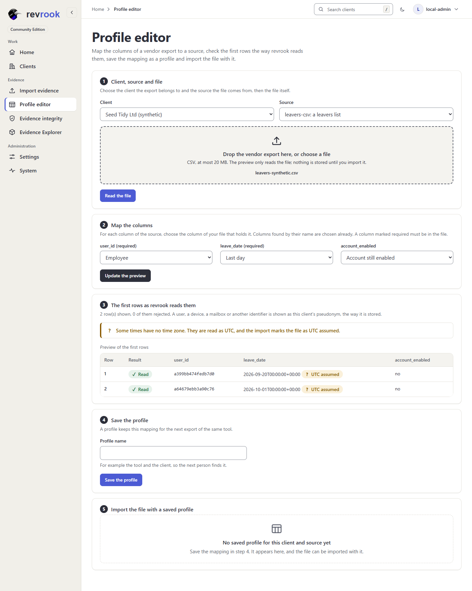
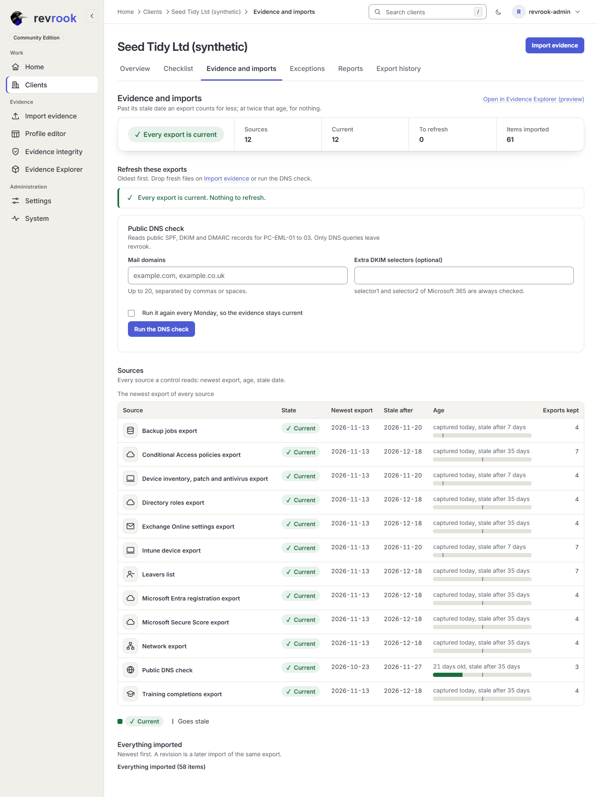
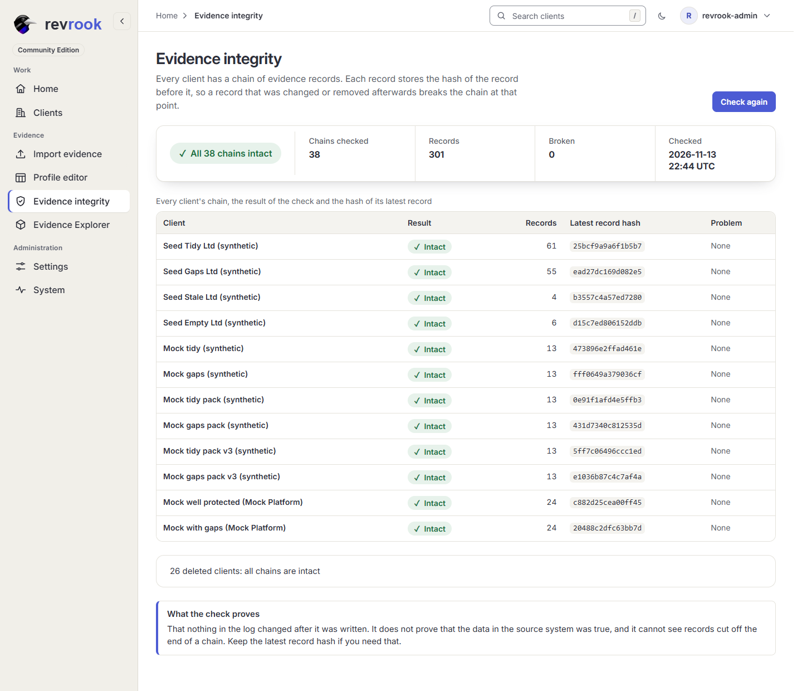

# 3. Import evidence

Evidence is the export of a tool, with the time it was captured. The usual way to
bring it in is the **Import evidence** page: drop every export of a client on it at
once and revrook recognises each file by its columns. Two other ways remain: the
**Profile editor**, for a vendor export whose columns have other names
([the profile editor](#the-profile-editor-for-an-export-with-other-column-names)),
and the API (`POST /api/v1/clients/{id}/evidence`, used by `scripts/demo.sh`). Which
exports exist and what each column means is in [importers](../importers.md).

Two sources are not files: the public DNS check runs from the evidence page of a
client ([11. The public DNS check](11-public-dns-check.md)), and the six Microsoft 365
files are written for you by a script ([10. Export Microsoft 365 with the
script](10-microsoft-365-export.md)) and then dropped on this page like any other.

## The import page, in three steps

Open **Import evidence** in the Evidence group of the rail, or press **Import
evidence** on the evidence page of a client, which opens the page on that client.

1. **Client and files.** Choose the **Client**. Leave **When the files were exported
   (UTC)** at now, or set it to the time the tool made the exports: it is used for the
   CSV files, which carry no time of their own, while a Microsoft Graph file keeps the
   time it says it was made. Drop the exports on the area, or choose them: CSV or JSON,
   up to 20 files and 20 MB in all. The names of the chosen files appear under the
   area.
2. **Import the files.** Nobody picks a source: each file is matched to the source
   whose columns (a CSV) or fields (a Graph JSON file) it has. A Graph answer without
   a record, a tenant with no Conditional Access policy for example, is recognised by
   its `@odata.context`. When two sources fit a file, the one that finds the most of
   its columns wins; a tie is not guessed, and the file is refused with the names of
   the sources, to be imported from the profile editor.
3. **Read the result.** Every recognised file is stored on its own, as an import
   through the API would store it, so a file that is refused (a duplicate, a missing
   column, columns that match no source) stops none of the others. The table names
   each file, its source, what happened to it, the facts stored and the rows refused.
   The file name is shown in this table only and is never stored.

The links above the table open the evidence page or the checklist of the client.
Every control that reads a source takes its status from the newest export of that
source; the others keep their status until their own export is imported. The score
on the clients list and on Home comes from the newest report, so make a report to
carry the change there ([6. Reports and exports](06-reports-and-exports.md)).

**What revrook recognises**, under the form, lists every source a file can feed and
what kind of file each one is (CSV, or JSON from Microsoft Graph), with the link to
the Microsoft 365 export script. The internal reference user list that the tests use
is not offered: no page, list or report shows it.

## The profile editor, for an export with other column names

A tool whose export has other column names than the ones revrook expects is mapped
once in the **Profile editor** (in the Evidence group). The saved mapping is then
recognised on Import evidence from then on, so the next export of that tool is
dropped there like any other; for its source, the saved mapping wins over name
matching.

1. **Client, source and file.** Choose the client, the source the file comes from
   (for example `leavers-csv: a leavers list`) and drop the vendor export on the import
   area or choose it. CSV only, at most 20 MB. Press **Read the file**. The preview only
   reads the file; nothing is stored until step 5.
2. **Map the columns.** For each column of the source, choose the column of your file
   that holds it. Columns found by their name are chosen already; a column marked
   required must be in the file. **Update the preview** re-reads the file with the new
   mapping. Columns the importer never reads (serial numbers, client names) are not
   offered, and the page says how many were hidden.
3. **The first rows as revrook reads them.** The first 20 rows, with the result of each
   (**Read** or the reason it would be rejected). A user, a device or another identifier
   is shown as the client's pseudonym, the way it is stored. A time without a time zone
   is marked **UTC assumed**.
4. **Save the profile.** Give the mapping a **Profile name** (for example the tool and
   the client) and press **Save the profile**. A missing required column refuses the
   save and is listed by name.
5. **Import the file with a saved profile.** Choose the **Saved profile**, set **When
   the export was taken (UTC)** and press **Import the file**; or, from now on, drop
   the file on Import evidence, which recognises the saved mapping.

## The evidence page of a client

Open the client and its tab **Evidence and imports**.

- The verdict band: the state of the client's evidence as one pill, with the sources,
  the current ones, the ones to refresh and the items imported.
- **How old is each export**: one bar per source on the same scale, its age against the
  mark where it goes stale; a bar opens its row in the sources table.
- **Refresh these exports**: a numbered list in the order to work in, the oldest export
  first, then the sources never imported.
- **Public DNS check**: the card that runs the check of the client's mail domains,
  once or every Monday ([11. The public DNS check](11-public-dns-check.md)).
- **Sources**: every source a control reads, with its newest export and the date it
  goes stale. An export is measured by the strictest control that reads it, the way
  the checklist measures it: a device export goes stale after 7 days, not after the
  35 days of the store, so this page and the checklist agree. An export that is out of
  date counts for less, and for nothing at twice its age
  ([scoring engine](../scoring-engine.md)).
- **Everything imported**: every evidence item, newest first, with its type, capture
  date, state, revisions and size. A revision is a later import of the same export.

## Check the hash chains

Every client has a chain of evidence records; each record stores the hash of the one
before it, so a record changed or removed afterwards breaks the chain at that point.

1. Open **Evidence integrity** in the Evidence group.
2. Press **Check all chains** (or **Check again** once a check has run).
3. The verdict says how many chains are intact or broken, with the records and the
   time of the check; the table shows every client's chain, its result, its records and
   the hash of its latest record. The chains of deleted clients stay, by design, so the
   deletion itself can be proved; while they are intact they are folded into one line
   under the table, which opens to list them.

What the check proves: that nothing in the log changed after it was written. It does
not prove that the data in the source system was true, and it cannot see records cut
off the end of a chain; keep the latest record hash if you need that. The same check
runs from the command line as `verify-chain` ([operations](../operations.md#restore)).

Next: [4. The checklist and the notes of a control](04-checklist-and-control-notes.md).
