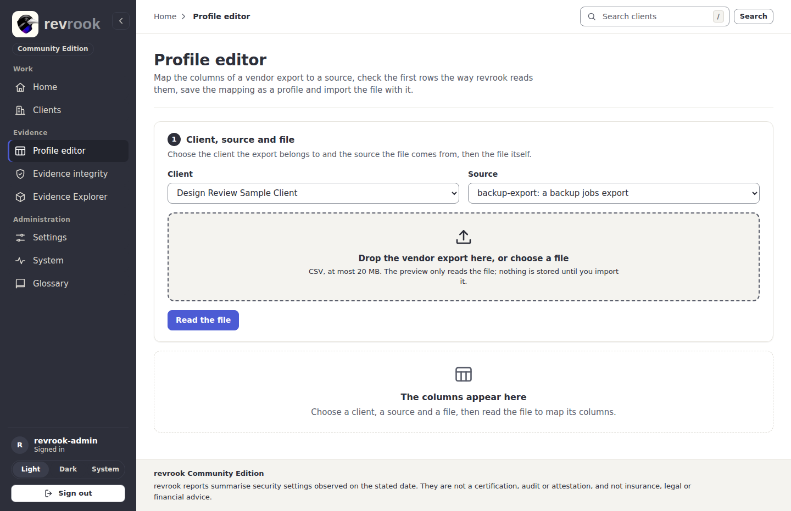
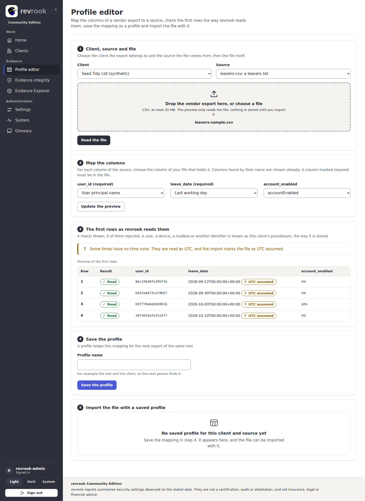
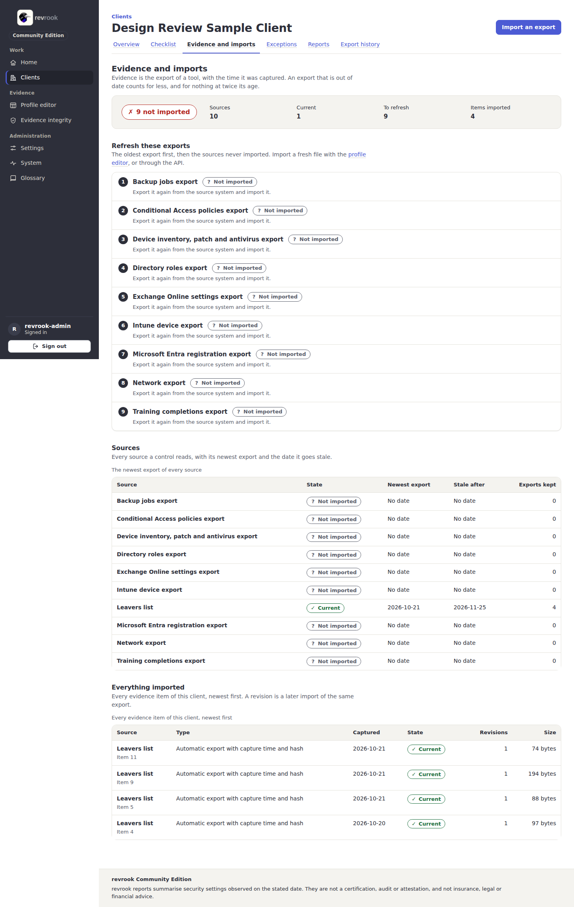
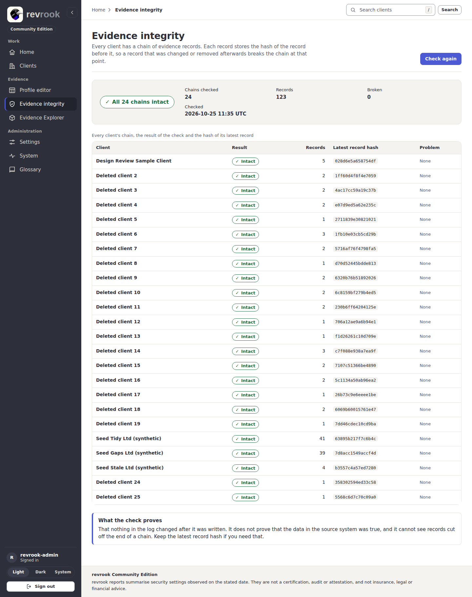

# 3. Import evidence

Evidence is the export of a tool, with the time it was captured. There are two ways to
import one: the API (`POST /api/v1/clients/{id}/evidence`, used by `scripts/demo.sh`)
and the **Profile editor** page, which also maps a file whose columns have other names.
Which exports exist and what each column means is in [importers](../importers.md).

The public DNS check (SPF, DKIM and DMARC) has no page: it is started through the API
or a worker schedule ([dns-check](../dns-check.md)).

## The profile editor, in five steps

Open **Profile editor** in the Evidence group (or **Import an export** on the evidence
page of a client, which opens the editor on that client).

1. **Client, source and file.** Choose the client, the source the file comes from
   (for example `leavers-csv: a leavers list`) and drop the vendor export on the import
   area or choose it. CSV only, at most 20 MB. Press **Read the file**. The preview only
   reads the file; nothing is stored until step 5.
2. **Map the columns.** For each column of the source, choose the column of your file
   that holds it. Columns found by their name are chosen already; a column marked
   required must be in the file. **Update the preview** re-reads the file with the new
   mapping. Columns the importer never reads (serial numbers, client names) are not
   offered, and the page says how many were hidden.
3. **The first rows as revrook reads them.** The first 20 rows, with the result of each
   (**Read** or the reason it would be rejected). A user, a device or another identifier
   is shown as the client's pseudonym, the way it is stored. A time without a time zone
   is marked **UTC assumed**.
4. **Save the profile.** Give the mapping a **Profile name** (for example the tool and
   the client) and press **Save the profile**. A missing required column refuses the
   save and is listed by name.
5. **Import the file with a saved profile.** Choose the **Saved profile**, set **When
   the export was taken (UTC)** (the time the tool made the export, not the time of
   this import) and press **Import the file**.

The result card names the evidence item, the profile and the facts stored, and says
which controls read this export: the others keep their status until their own export
is imported. The score on the clients list and on Home comes from the newest report, so
make a report to carry the change there ([6. Reports and exports](06-reports-and-exports.md)).

## The evidence page of a client

Open the client and its tab **Evidence and imports**.

- The verdict band: the state of the client's evidence as one pill, with the sources,
  the current ones, the ones to refresh and the items imported.
- **Refresh these exports**: a numbered list in the order to work in, the oldest export
  first, then the sources never imported.
- **Sources**: every source a control reads, with its newest export and the date it
  goes stale. An export that is out of date counts for less, and for nothing at twice
  its age ([scoring engine](../scoring-engine.md)).
- **Everything imported**: every evidence item, newest first, with its type, capture
  date, state, revisions and size. A revision is a later import of the same export.

## Check the hash chains

Every client has a chain of evidence records; each record stores the hash of the one
before it, so a record changed or removed afterwards breaks the chain at that point.

1. Open **Evidence integrity** in the Evidence group.
2. Press **Check all chains** (or **Check again** once a check has run).
3. The verdict says how many chains are intact or broken, with the records and the
   time of the check; the table shows every client's chain, its result, its records and
   the hash of its latest record.

What the check proves: that nothing in the log changed after it was written. It does
not prove that the data in the source system was true, and it cannot see records cut
off the end of a chain; keep the latest record hash if you need that. The same check
runs from the command line as `verify-chain` ([operations](../operations.md#restore)).

Next: [4. The checklist and the notes of a control](04-checklist-and-control-notes.md).
