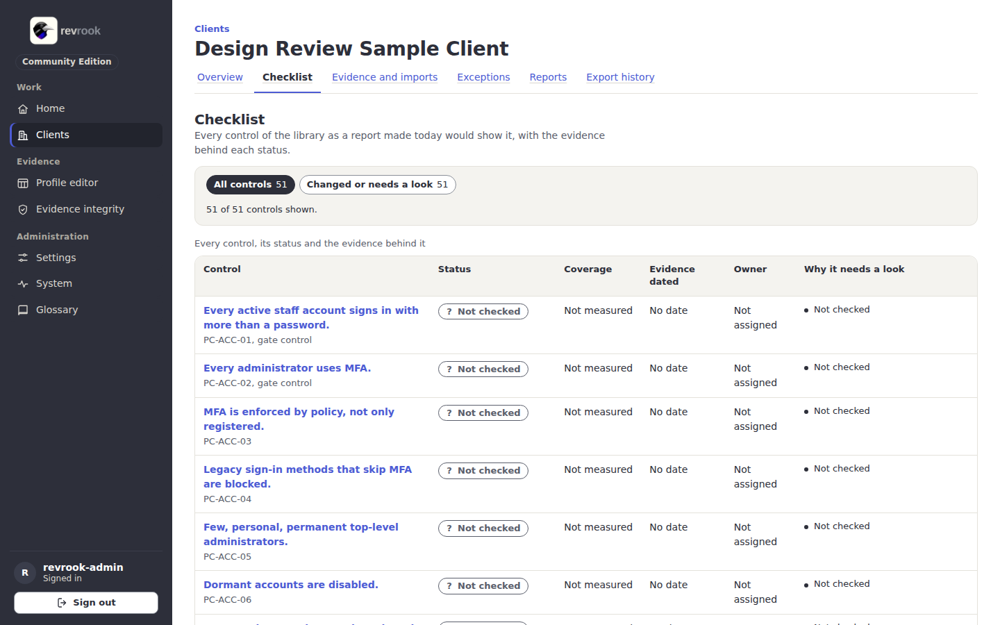
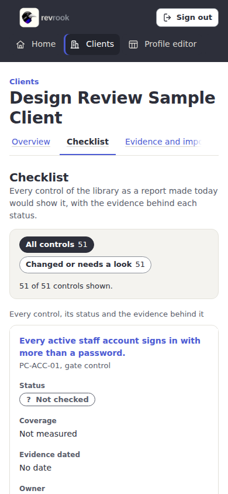
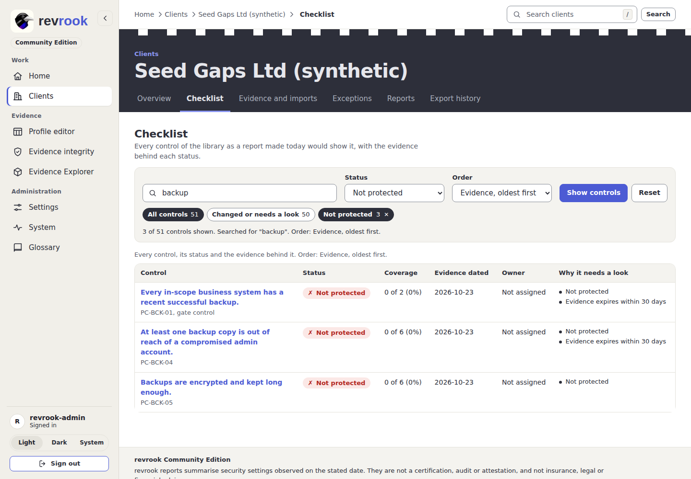
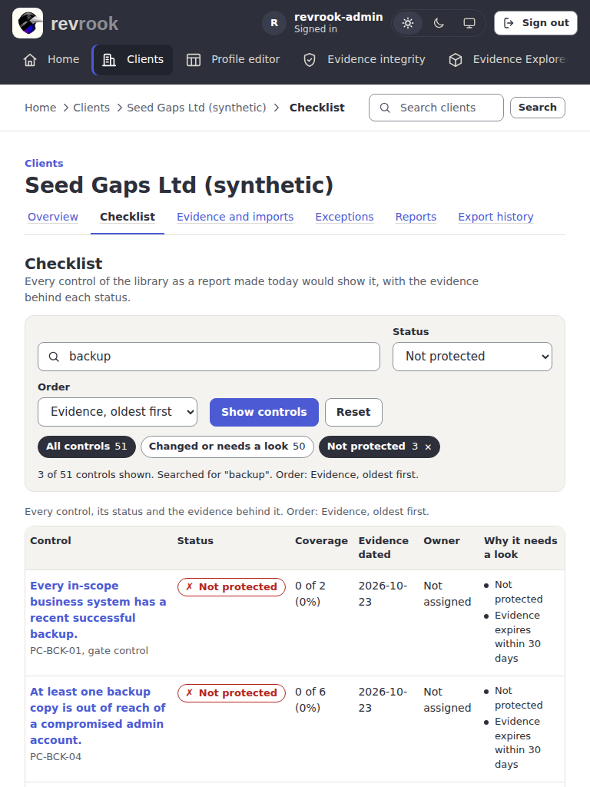
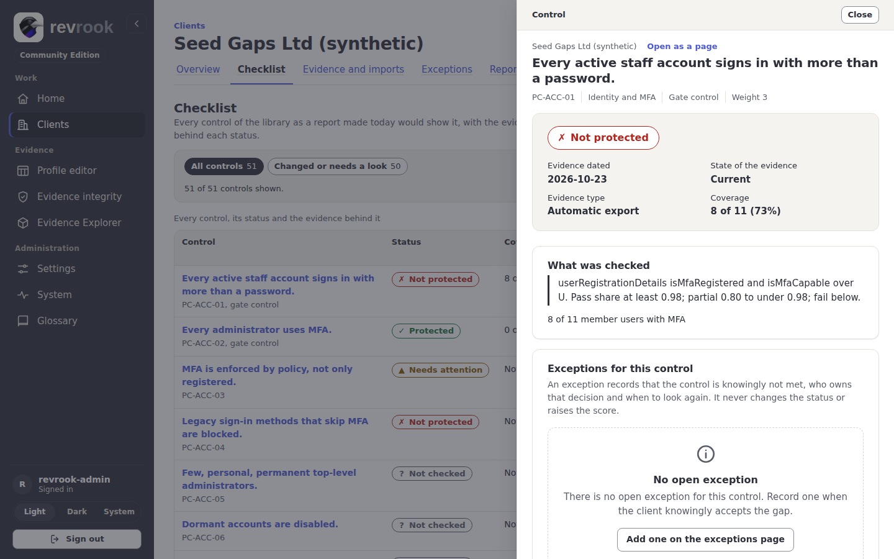

# 4. The checklist and the notes of a control

## The checklist

Open a client and its tab **Checklist**. It lists the 51 controls of the library as a
report made today would show them, with the evidence behind each status.

- The tools of the list sit in one band above it: a search over the name, the id, the
  domain and the owner of each control, a **Status** menu, an **Order** menu and **Show
  controls** (see [Search, filter and order the checklist](#search-filter-and-order-the-checklist)).
- Under the tools two chips with counts: **All controls** and **Changed or needs a
  look** (the controls whose status changed since the last report or that need
  attention). The line under them says how many rows are shown, the words searched for
  and the order in use.
- In **Library order** the rows are grouped by domain, each group headed by a row
  with the name of the domain and how many controls it holds.
- Each row: the control in plain language with its identifier and whether it is a gate
  control, the **Status** as an icon and words (Protected, Needs attention, Not
  protected, Not checked), the **Coverage**, the date of the evidence, the **Owner** of
  the open exception if any, and **Why it needs a look**.
- A violet mark on a row means its status changed since the last report. The head of
  the table stays in view while you scroll; on a phone every control is a card whose
  facts run as short lines, the label beside its value.

A status is never shown by colour alone. **Not checked** means nothing was verified:
there is no dated evidence for the control ([controls](../controls.md)).

## Search, filter and order the checklist

1. Type part of a name, an identifier (for example `PC-ACC`), a domain or an owner into
   **Search by name, id, domain or owner**.
2. Choose a **Status** (**Any status**, or one of Protected, Needs attention, Not
   protected, Not checked and Not applicable).
3. Choose an **Order**: **Library order** (the order of the report, the default),
   **Status, worst first** (then the gate controls, then the heaviest), **Evidence,
   oldest first** (the controls without dated evidence at the top) or **Name, A to Z**.
4. Press **Show controls**. Nothing changes until you press it, and the address of the
   page names what is shown, so a bookmark or a link opens the same view.
5. **Reset** appears once a search, a status or another order is in use and takes those
   three away.

The chips and the narrowing from a chart segment keep the search and the order. The
caption of the table names the order in the words of the menu, and the sorted column is
announced to a screen reader. A search with no match says what was searched for and
within which chip, with a way back to every control.

The tools wrap to the width they have. At 1440 px they stand on one row, **Reset**
included. When there is less room they take two rows: at 768 px the search and
**Status** share the first row and **Order**, **Show controls** and **Reset** the second,
as in the picture below. Below 600 px each takes the whole width.

## The drawer and the page of a control

Press the name of a control on the checklist, or a control or **Open** in a Needs
attention list on Home or on a client overview. With script, a drawer opens at the
right edge over the page (608 px wide from 768 px) with the same verdict, evidence,
exceptions and notes as the page of the control; focus moves to its title, and
**Close** or Escape puts it away and gives focus back to the link you pressed. **Open
as a page** at its top opens the full page of the control. Without script, or with a
modifier key held, the same links open that page directly.

The page of a control:

1. The verdict band: the status as a large pill beside the facts of the evidence (the
   date, its state, its type and the coverage).
2. **What was checked**: the finding, for example how many member users have MFA, and
   **Read from**, the sources the control reads, by name. **The rule as the library
   writes it** is folded under them; press it to read the rule with its field names.
3. **Exceptions for this control**: the open exception with its owner and review date,
   or the empty state with **Add one on the exceptions page**
   ([5. Exceptions](05-exceptions.md)).
4. **Your notes**: the four lines the report prints for this control, **What we did**,
   **What we recommend**, **What we need from you** and **By when**, with a suggested
   wording above them. Notes are saved as you type (the card says "Saving" while a
   note is posted); **Save notes** posts them without script.

To change a status, import newer evidence ([3. Import evidence](03-import-evidence.md)):
notes and exceptions never change a status and never raise the score.

Next: [5. Exceptions](05-exceptions.md).
