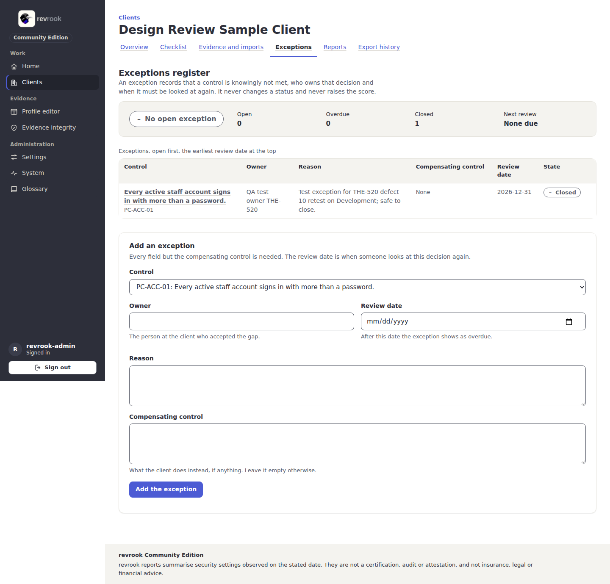

# 5. Exceptions

An exception records that a control is knowingly not met, who at the client owns that
decision and when it must be looked at again. It never changes a status and never
raises the score; it is printed in the reports so that the gap is on record.

Open a client and its tab **Exceptions**.

## Read the register

- The verdict band: how many exceptions are open and overdue, how many are closed, and
  the next review date.
- **Reviews in the coming year**: the year ahead as one line, today at its left end,
  every open exception a mark at its review date and those past their date stacked
  before today. The words beside it and the register under it carry the same dates.
- The table lists the exceptions, open first, the earliest review date at the top:
  the control, the owner, the reason, the compensating control, the review date with
  how many days are left or late, and the state (**Open**, **Overdue** after the review
  date, **Closed**). From 768 px to 1279 px each exception is a card.

## Add an exception

1. In **Add an exception**, choose the **Control**.
2. Type the **Owner** (the person at the client who accepted the gap) and the **Review
   date** (after it the exception shows as overdue).
3. Write the **Reason**, and the **Compensating control** if the client does something
   instead (leave it empty otherwise).
4. Press **Add the exception**. The page reloads with a message and the new row; the
   control page shows the exception from now on.

## Close an exception

Press **Close this exception** on its row. The row stays in the register as closed, and
the audit trail of the client records who closed it and when.

Next: [6. Reports and exports](06-reports-and-exports.md).
