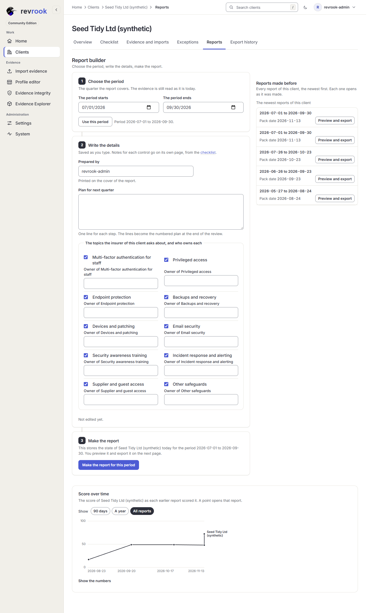
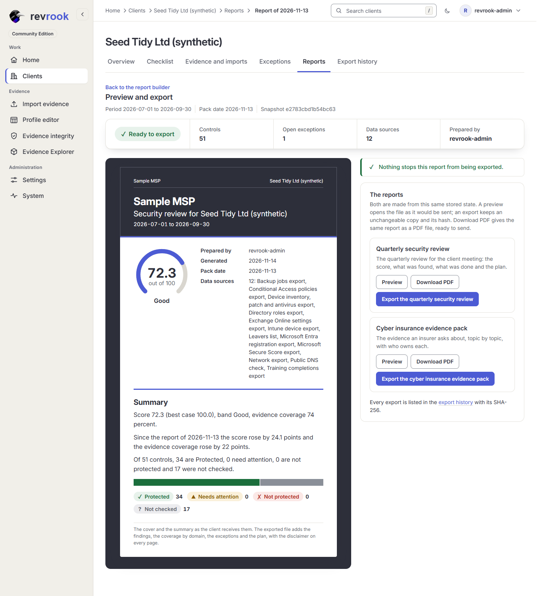
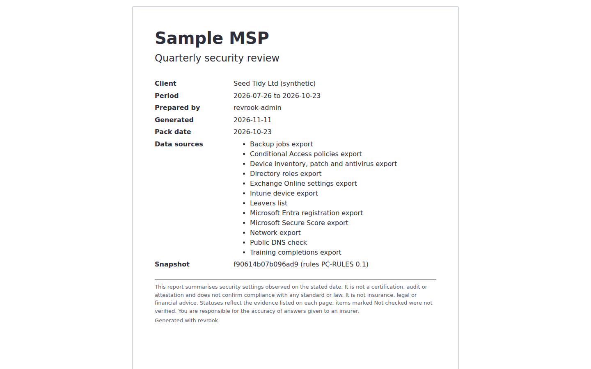
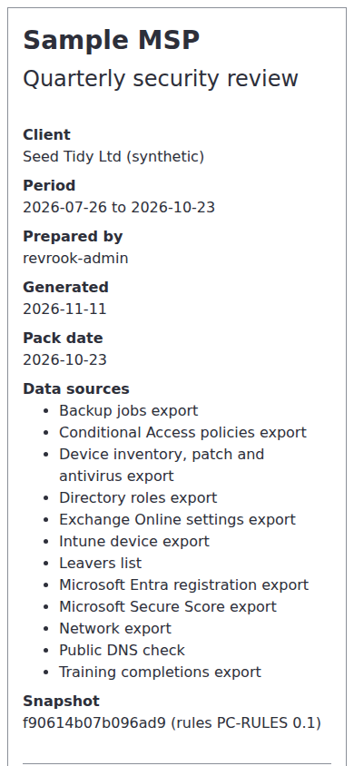
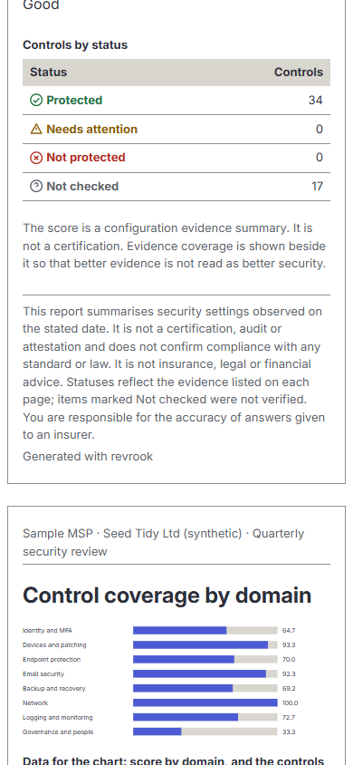
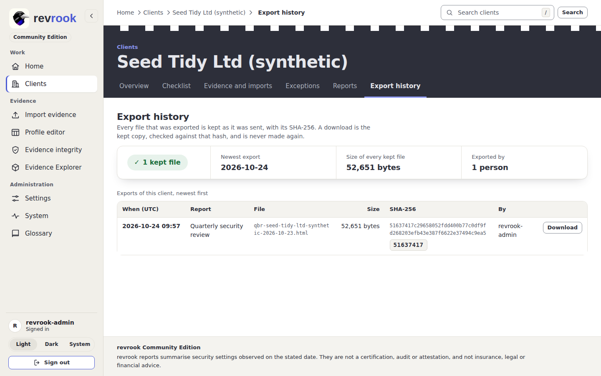

# 6. Reports and exports

Two reports are made from one stored state of a client: the **quarterly security
review** and the **cyber insurance evidence pack**, each as one HTML file with print
styles ([reports](../reports.md)). There is no PDF export in the Community Edition:
print the HTML file to PDF from the browser if you need one.

Before the first export, set the name of your business in **Settings**
([1. First start](01-first-start.md)).

## The report builder

Open a client and its tab **Reports** (or **Prepare a report** on the overview).

1. **Choose the period.** The quarter the report covers; the last full quarter is
   chosen for you. Change the dates if you like and press **Use this period**. The
   evidence is still read as it is today. A period may not be longer than 400 days or
   end in the future.
2. **Write the details.** **Prepared by** goes on the cover; **Plan for next quarter**
   is one line per step and becomes the numbered plan at the end of the review; the
   insurance topics and the owner of each go into the pack. Everything here is saved as
   you type (the line under the form says "Not edited yet." until then, and when it was
   saved); without script a **Save the details** button posts it instead. The notes for each control are written on its own page
   ([4. The checklist](04-checklist-and-control-notes.md)); the review prints only
   the notes that were written, never a placeholder for an empty one.
3. **Make the report.** Press **Make the report for this period**. This stores the
   state of the client today as a snapshot and opens the preview page. A second press
   within 30 seconds opens the report the first press made instead of storing another.

The three steps are joined by a line down their left side. **Reports made before**
lists every report of this client, the newest first, with its period and pack date;
**Preview and export** opens each from the snapshot it was made from. From 1280 px it
stands beside the steps. **Score over time**, under them, draws the score of this client
at every report made before (90 days, a year or all reports); a point opens that
report.

## Preview and export

- The band says whether the report is ready to export, with the controls, the open
  exceptions, the data sources and the preparer. **Before you export** lists what
  stops an export, each line saying what is missing; the usual first one is the
  business name.
- The paper sheet, white in both themes and set in a charcoal frame, is a short reading of the report: the period,
  the pack date, the summary sentence and the counts by status. The file itself, with its cover, is what **Preview** opens.
- **The reports**: for each of the two, **Preview** opens the file as it would be sent,
  and **Export the quarterly security review** or **Export the cyber insurance
  evidence pack** keeps an unchangeable copy and its SHA-256 and opens the export
  history.
- A file is made from the stored snapshot together with what is current when it is
  made: the details of step 2, the open exceptions of the client and the date it is
  generated. A preview or an export made later of the same report therefore shows an
  exception recorded after the snapshot, and the band counts it. The same snapshot,
  details, exceptions and date give the same bytes, and the export history keeps every
  exported file exactly as it was sent.

## The rendered report

**Preview** of the quarterly security review opens the file itself, as the client
receives it: one HTML file laid out as sheets of paper. The cover opens with a dark
head: your logo when one is set in Settings, the name of your business, the report,
the client and the period. Under it stand the score as a dial with its band, who
prepared it (the name you chose on the Account page), the date it was generated, the
pack date, the data sources and the id of the snapshot it was made from, followed by
the disclaimer that every report prints.

After the cover come the summary (score, evidence coverage and band in one row, and
the controls by status as one bar above their table), the coverage by domain, and the
**top findings**. A finding names the control and its status, the evidence it was read
from and its date, **what was checked** (what the check found when the report was
made) and, when you wrote no recommendation for it, the **usual next step** of that
control; what you write under **What we recommend** takes its place. **What could not
be checked** lists the kinds of evidence the unchecked controls wait for. The roadmap
and the plan for next quarter are printed only when you wrote them.

The whole file, from the cover to the appendix of each domain and the important
notice, is one tall picture in
[report-preview-file-full-1440.png](../images/report-preview-file-full-1440.png); its
sections are described in [reports](../reports.md). The cyber insurance evidence pack
opens the same way from its own **Preview** and is not pictured here.

## A report on a phone

The file fits a narrow screen as well as paper. Below about 640 px it has less padding,
the dial above the facts of the cover, a smaller title, and the page never scrolls
sideways. A table that is still wider than the screen scrolls inside its own frame:
swipe it, or give it focus with Tab and use the arrow keys. Its caption stays whole at
the left edge while the columns move, and a date in a table is never broken across
lines. Printed, or saved as a PDF from the browser, the report keeps the A4 layout:
the cover is a sheet of its own, short sections follow one another, every sheet
carries its number and the colours print without the background option.

## The export history

Open the tab **Export history** of the client.

The verdict band counts the kept files, the newest export, their size and who exported
them. Every file that was exported is kept as it was sent, with the time (UTC), the
report, the file name, the size, the SHA-256 and who exported it; under each SHA-256
its first eight characters stand as the seal of the row, to compare by eye with the
copy a client holds. **Download** sends the kept
copy, checked against that hash, and never makes it again; a copy altered on disk is
reported instead of sent. Deleting the client deletes its exports.

Next: [7. Settings, System and the glossary](07-settings-system-and-glossary.md).
