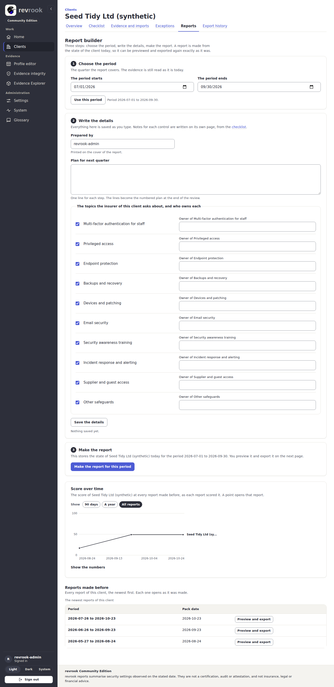
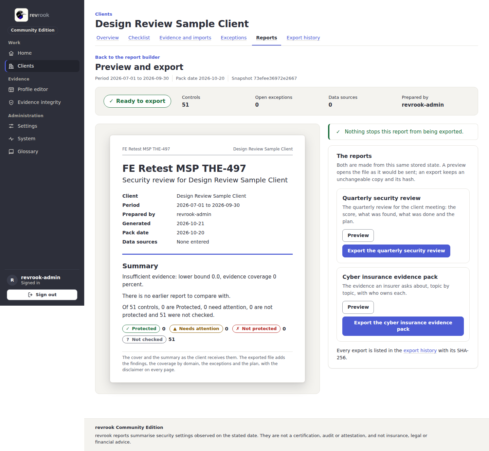
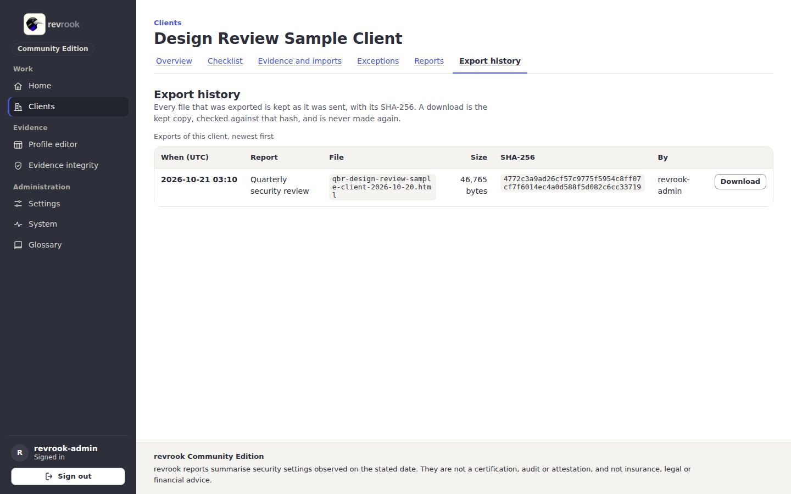

# 6. Reports and exports

Two reports are made from one stored state of a client: the **quarterly security
review** and the **cyber insurance evidence pack**, each as one HTML file with print
styles ([reports](../reports.md)). There is no PDF export in the Community Edition:
print the HTML file to PDF from the browser if you need one.

Before the first export, set the name of your business in **Settings**
([1. First start](01-first-start.md)).

## The report builder

Open a client and its tab **Reports** (or **Prepare a report** on the overview).

1. **Choose the period.** The quarter the report covers; the last full quarter is
   chosen for you. Change the dates if you like and press **Use this period**. The
   evidence is still read as it is today. A period may not be longer than 400 days or
   end in the future.
2. **Write the details.** **Prepared by** goes on the cover; **Plan for next quarter**
   is one line per step and becomes the numbered plan at the end of the review; the
   insurance topics and the owner of each go into the pack. Everything here is saved as
   you type (the line under the form shows when); **Save the details** posts it without
   script. The notes for each control are written on its own page
   ([4. The checklist](04-checklist-and-control-notes.md)).
3. **Make the report.** Press **Make the report for this period**. This stores the
   state of the client today as a snapshot and opens the preview page. A second press
   within 30 seconds opens the report the first press made instead of storing another.

**Reports made before** lists every report of this client, the newest first, with its
period and pack date; **Preview and export** opens each as it was made.

## Preview and export

- The band says whether the report is ready to export, with the controls, the open
  exceptions, the data sources and the preparer. **Before you export** lists what
  stops an export, each line saying what is missing; the usual first one is the
  business name.
- The paper sheet shows the cover and the summary as the client receives them: the
  period, the pack date, the summary sentence and the counts by status.
- **The reports**: for each of the two, **Preview** opens the file as it would be sent,
  and **Export the quarterly security review** or **Export the cyber insurance
  evidence pack** keeps an unchangeable copy and its SHA-256 and opens the export
  history. The same snapshot and the same details give the same bytes.

The rendered report file itself (what **Preview** opens) is not pictured in this guide.

## The export history

Open the tab **Export history** of the client.

Every file that was exported is kept as it was sent, with the time (UTC), the report,
the file name, the size, the SHA-256 and who exported it. **Download** sends the kept
copy, checked against that hash, and never makes it again; a copy altered on disk is
reported instead of sent. Deleting the client deletes its exports.

Next: [7. Settings, System and the glossary](07-settings-system-and-glossary.md).
