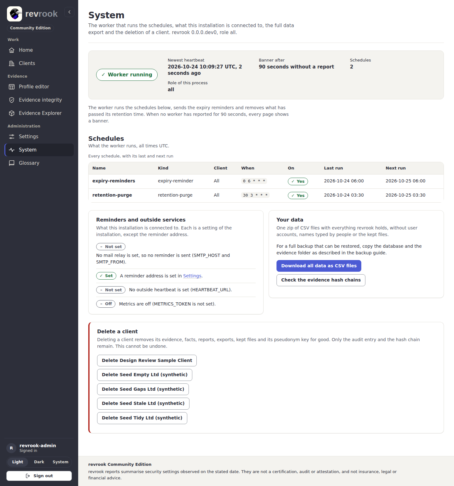
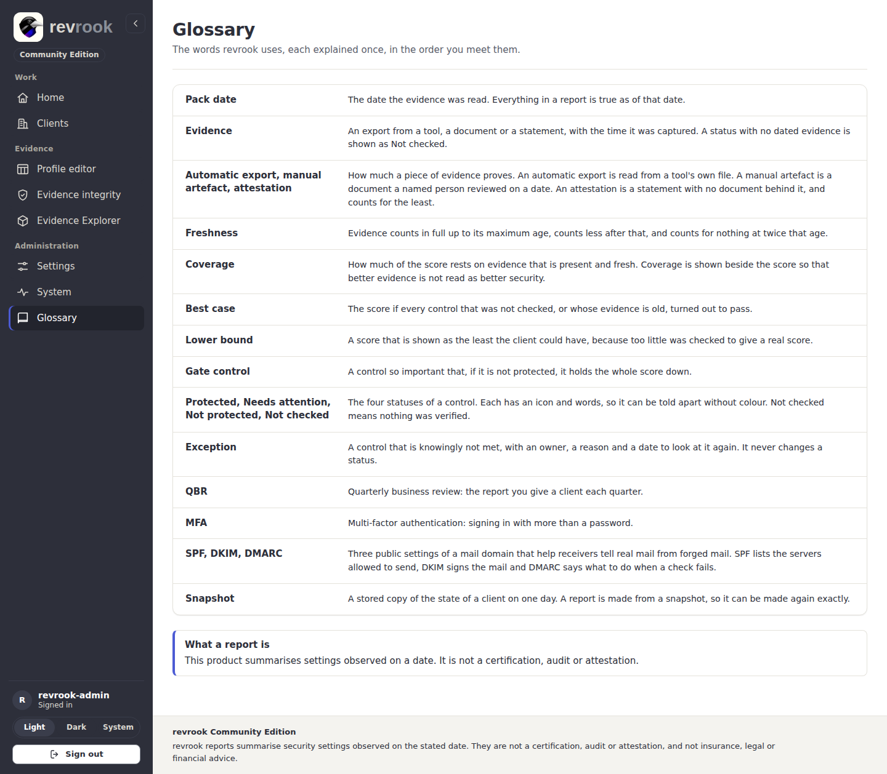
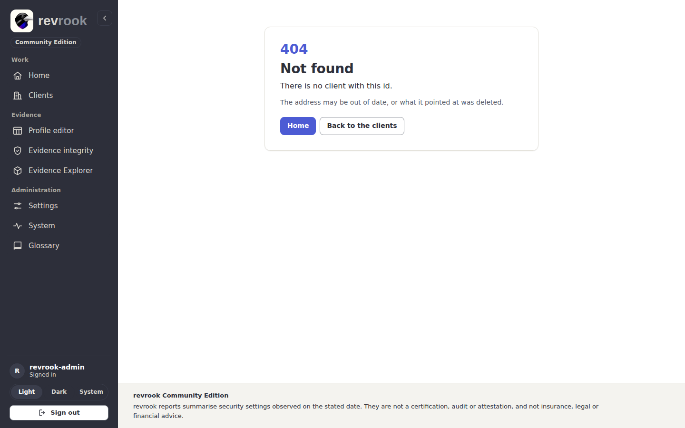

# 7. Settings, System and the glossary

## Settings

Open **Settings** in the Administration group.

- **Your business**: the name printed on every report and the address the evidence
  expiry reminders go to. These two are the only settings of the page; **Save** stores
  them.
- **Fixed by the rules and the installation**, shown so you know what every report says
  and keeps: the disclaimer in every report, the retention and limits of the
  installation (raw files after import, reports and snapshots, largest import; these
  are environment variables, [configuration](../configuration.md)), the weights of the
  eight domains under the rules PC-RULES 0.1, everyone who can sign in (the one
  administrator) and the note that a mapping to another framework is shown in a report
  only after a person has checked it against its source. None is shown until then
  ([mapping verification](../mapping-verification.md)).

The picture stops above the weights of the domains and **Users and mappings**. On the
shared Development installation that card also lists a second sign-in account created
by the Development seed (`DEV_SEED_ACCOUNTS` in `deploy/dokploy.json`), and its address
is kept out of every picture ([capture manifest](../images/README.md)).

## System

Open **System** in the Administration group.

- The verdict band says whether the worker is running, the newest heartbeat, when the
  banner appears (90 seconds without a report), the schedules and the role of this
  process. The purpose line names the version the application reports.
- **Schedules**: what the worker runs, all times UTC, with the cron expression, whether
  it is on, and its last and next run. The two daily schedules, expiry reminders at
  06:00 and the retention purge at 03:30, are created by the worker
  ([operations](../operations.md#the-worker)).
- **Reminders and outside services**: whether a mail relay, a reminder address, an
  outside heartbeat and the metrics endpoint are set.
- **Your data**: **Download all data as CSV files** is one zip with everything revrook
  holds, without user accounts, names typed by people or the kept files; for a full
  backup that restores, copy the database and the evidence folder instead
  ([operations](../operations.md#backup)). **Check the evidence hash chains** opens the
  integrity page ([3. Import evidence](03-import-evidence.md#check-the-hash-chains)).
- **Delete a client**: press **Delete <client>** to open the confirmation, type the
  exact name of the client in the field it shows and press **Delete <client> for
  good**. Its evidence, facts, reports, exports, kept files and pseudonym key go for
  good; only the audit entry and the hash chain remain. This cannot be undone.

## The glossary

Open **Glossary** in the Administration group: the words revrook uses, each explained
once, in the order you meet them (pack date, evidence, the three evidence types,
freshness, coverage, best case, lower bound, gate control, the four statuses,
exception, QBR, MFA, SPF, DKIM and DMARC, snapshot), and what a report is.

## When a page does not exist

An address that answers nothing, an id that was deleted or a method a page does not
take shows the problem page with the status code, the message and two ways back
(**Home** and **Back to the clients**). The API, the probes and the static files keep
their JSON answers.

