# 8. Scenes, the folded rail and the Evidence Explorer

Three pages carry a scene drawn in the browser: the client street on **Home**, the
domain keep on the overview of a client, and the **Evidence Explorer** (the ring of
every company, or the evidence wall of one client). Each scene draws facts the page already shows: the cards, the bars and the
tables under it stay the record, and a scene adds nothing to a report. The scenes
start hidden: a page opens on its cards and bars, with the button **Show the 3D
view** above the stage, and nothing is drawn (and no scene library loaded) until you
press it ([hide or show the scenes](#hide-or-show-the-scenes)). The pictures of this
guide show the scenes after that press. How the scenes are built is in the
[design system](../design-system.md#scenes).

A scene needs script and a browser with WebGL 2. Without them the page is the cards,
the bars and the tables, with no empty box where the scene would be. When the browser
offers WebGL 2 but then refuses to start it (WebGL switched off or unavailable), the
stage shows a short note that says so instead of an empty drawing, and **Show the 3D
view** can try again. Nothing in the
rookery or the keep turns by itself, and when the system asks for reduced motion every
move is immediate.

## The rookery on Home

Under **What moves the score**, a keep panel holds the gauge of the mean score on its
left and the stage on its right. On the stage the clients stand as offices along a
street, with a road, a pavement, trees and street lamps (models of Kenney's City Kits,
www.kenney.nl, CC0). Each office is as tall as its score: a low building below 25, a
three-storey one from 25, a taller one from 50, a tower from 75 and the tallest towers
from 90. It is as wide as the company (its people in the newest Entra export, else its
devices). The light round its roof is its band: green for strong or good, amber for
fair, red for weak or critical. A building in scaffolding means the evidence is too thin
for a score (its height is then a lower bound); an empty, fenced lot means nothing is
imported yet; and every small red lit window on the street side is a control that needs
work. The models are fetched only when the 3D view is shown; if one cannot be loaded,
that office is drawn as a plain office built in code (2 to 12 floors for the score)
and the scene still works.

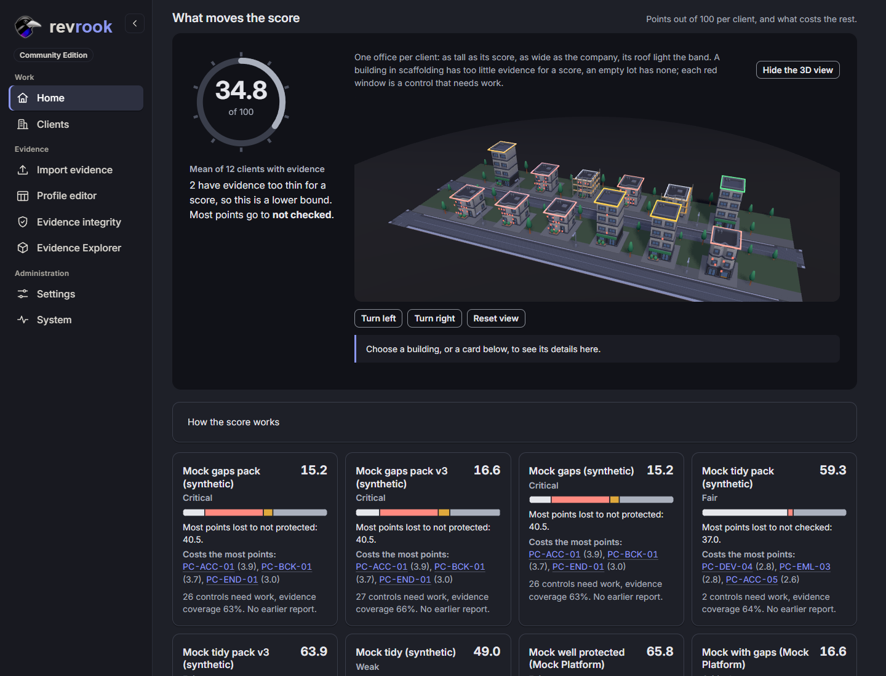

1. Hover over an office, or over its card, to read its name in the line under the stage.
2. Press an office to choose it: the others step back, its card in the score drivers gets
   the violet mark at its left edge, and the detail line under the buttons names the client, its score,
   its band and how many controls need work.
3. Or work from the keyboard: press Tab until the stage has focus, then **Left** and
   **Right** to choose the next client, **[** and **]** to turn the yard, **+** and
   **-** to move closer and away, **Home** to reset the view, **Enter** to open the
   chosen client and **Escape** to clear the choice.
4. **Turn left**, **Turn right** and **Reset view** under the stage do the same with the
   mouse or a touch; a drag turns and tilts the yard.

### The company card

Choosing an office opens its company card beside it, inside the stage: the client's
name (a link to the client), its score and band (**at least** and **Insufficient
evidence** when the evidence is too thin), **Needs work** with its three most urgent
controls in the order of Home's **Needs attention**, each a link to the control,
**Exports to refresh** with the number of its exports that are expired, stale or never
imported (a link to its evidence page), and the buttons **Open client**, **Checklist**
and **Evidence**. Choosing another office moves the card. Close it with its **x**
button, **Escape**, a press anywhere outside it, **Reset view** or **Hide the 3D view**.
When you choose with the keyboard the focus moves to the name on the card: **Left**,
**Right** and **Enter** still work from there, Tab reaches its links, and **Escape**
gives the focus back to the stage. On a stage narrower than 600 px (a phone) the card
stands under the stage. The ring of every client against every control is in the
[Evidence Explorer](#the-evidence-explorer).

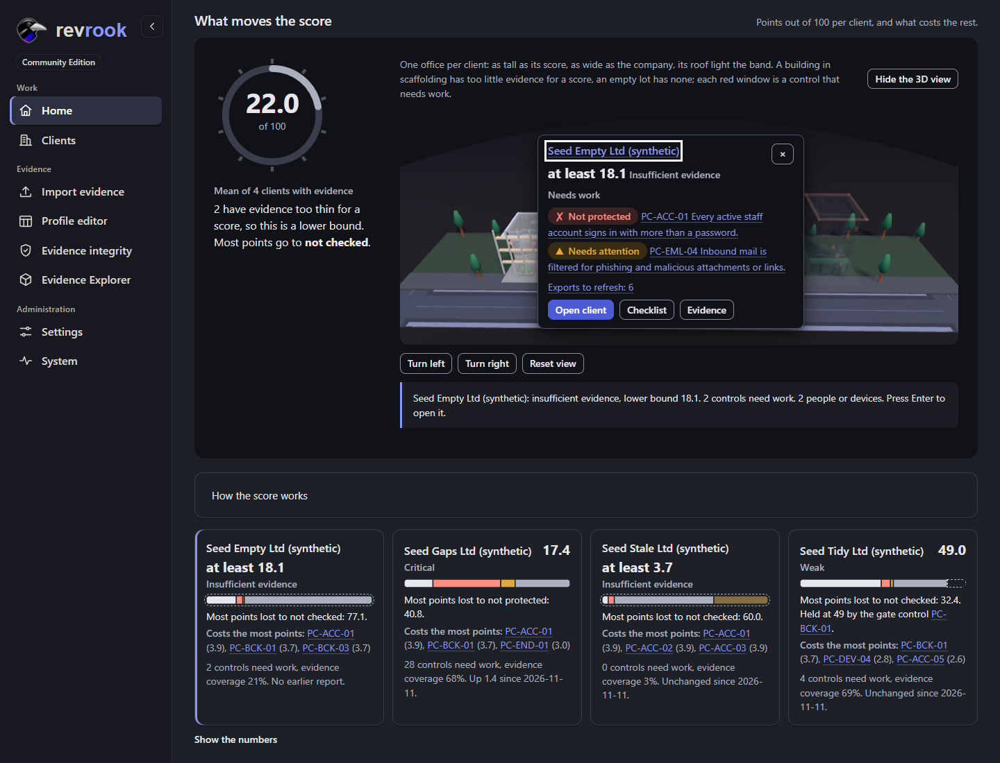

On a tablet the gauge stands above the stage, which spans the panel, and the cards
stand two to a row; on a phone the row of offices is fitted to the width of the stage, so
each office is small.

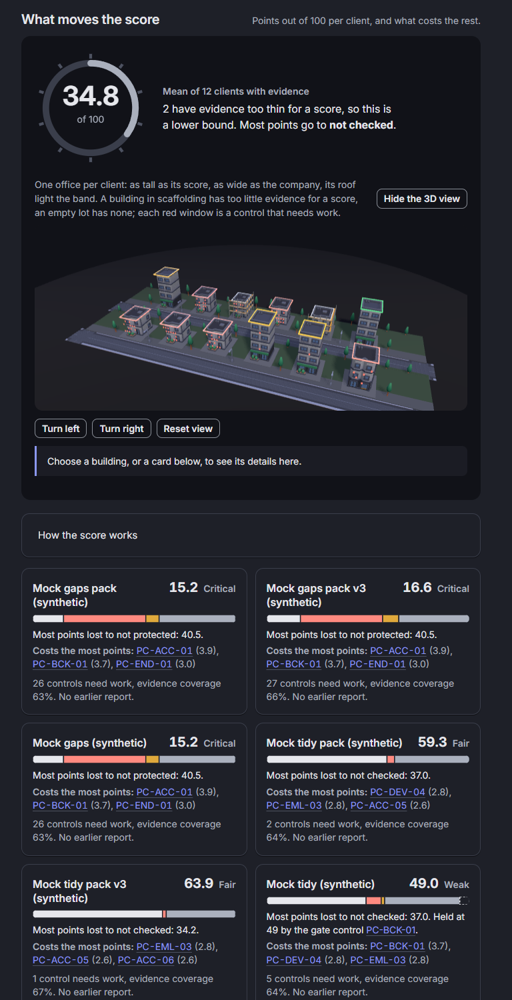

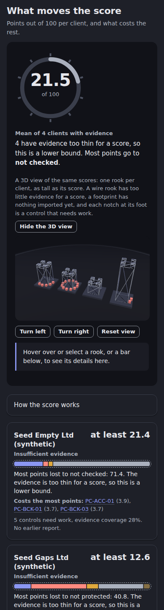

## The domain keep on a client overview

In **Coverage by domain** of a client overview, one block stands for each domain of the
control library, as wide as its weight in the score and built of its controls in
layers: protected at the foot, then needs attention, then not protected, and not
checked as wire, in the colours of the bars under it. A heavy domain with red layers
stands out at once.

1. Hover over a block, or over its bar, to read it in the line under the stage.
2. Press a block, or focus the stage and press **Left** or **Right**, to choose a
   domain: the detail line names its protected controls, its weight and its score, and
   its bar gets a line in the margin of the card.
3. **Enter** opens the checklist narrowed to that domain, the same link the bar
   carries. The other keys work as on Home.

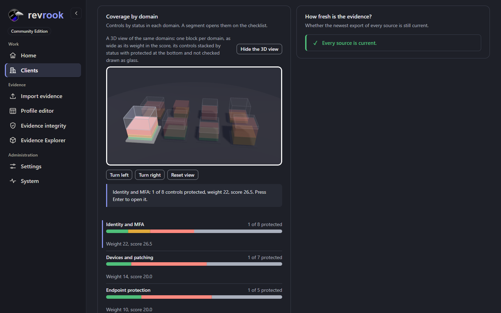

From 768 px down the card spans the page and the keep has more room. The view is
fitted from the corners of every block, so the whole keep stays inside its stage at
every width; from 600 px the stage is 16 by 9.

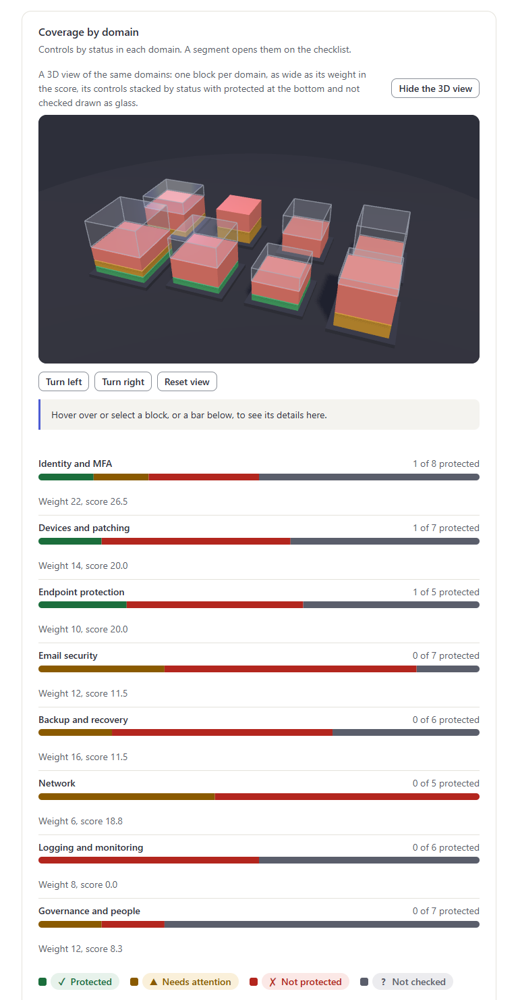

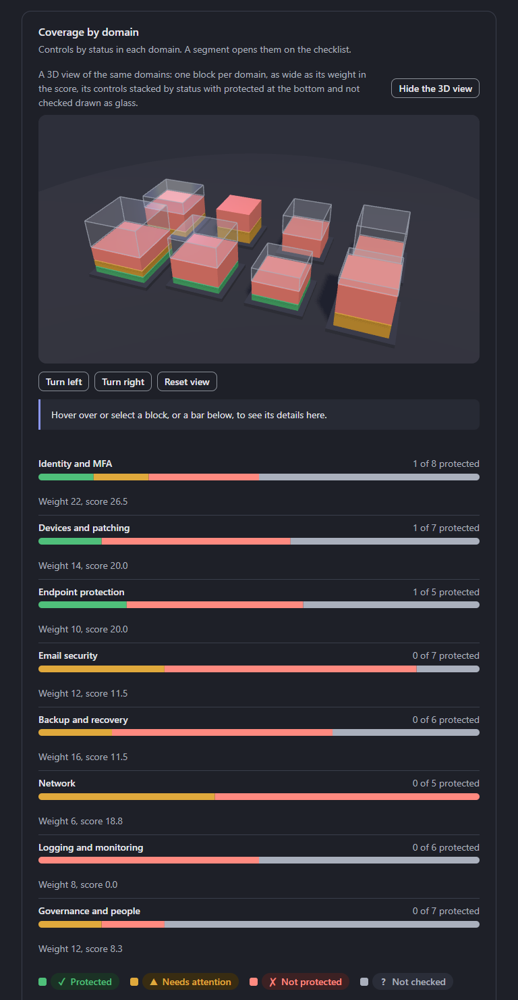

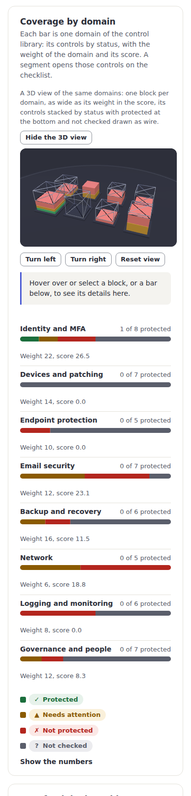

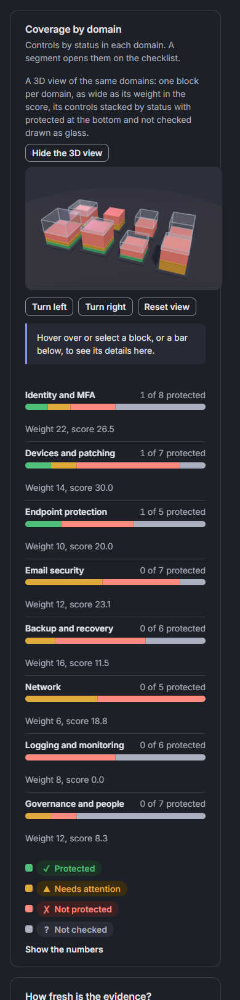

## Hide or show the scenes

A page opens with its scenes hidden: the lead line of the stage says what the 3D view
would show, and the button beside it reads **Show the 3D view**. On Home the gauge
keeps its place in the panel. Press the button and every stage of the page opens, the
library is loaded once, and the scene is drawn; the button then reads **Hide the 3D
view** and puts the scenes away again: the stage, its buttons and its detail line go,
and the cards and the bars stay where they were. The choice is kept in this browser
only (another browser, or another person, still opens on the cards), and it holds for
Home, the client overview and the Evidence Explorer together.

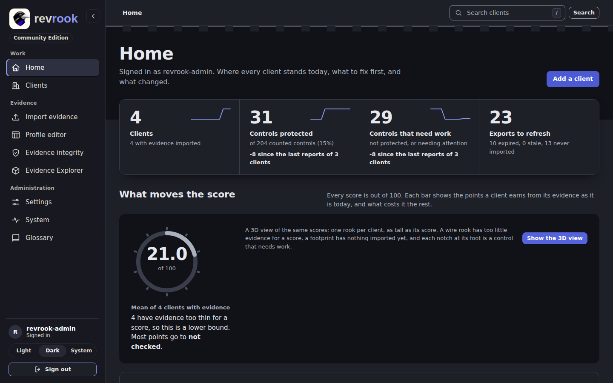

## Fold the rail

From 1024 px the navigation is a rail on the left. The button with the arrow at its
top, **Fold the rail**, folds it to a 72 px column of icons, so a wide table, a chart
or a scene gets the room. Point at an icon, or reach it with Tab, to read its name as
a tooltip; the current page keeps its mark. The same button, now **Open the rail**,
opens it again. The choice is remembered in this browser, so the next page is drawn
folded or open from the start. Below 1024 px the navigation is a bar at the top (its
links wrap onto more rows; on a phone they drop their icons) and the button is not
shown.

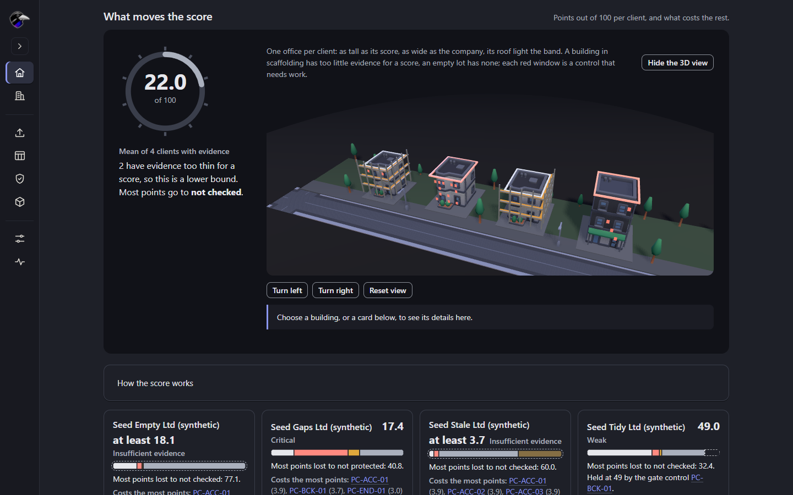

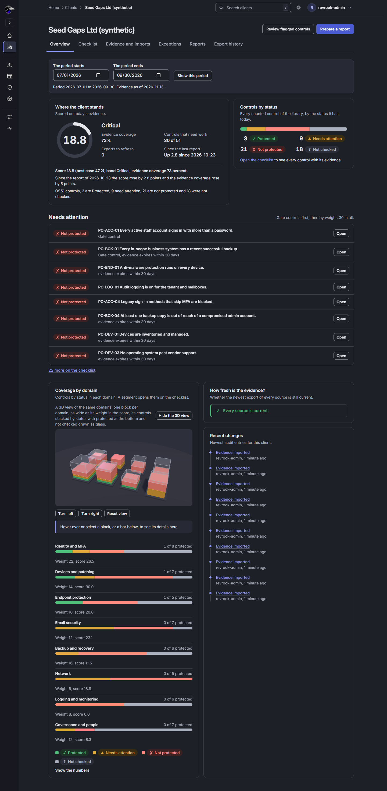

## Light, dark or the choice of the system

The sun or moon button in the top bar, beside the account menu, switches between
**Light** and **Dark** at once; **Account** in the account menu also offers **System**,
to follow the setting of the device. The choice is kept with your account (and in a cookie for the sign-in page),
so it follows you to another browser. The ground of every scene is the
same charcoal in both themes; the pictures of this guide show both.

## The Evidence Explorer

Press **Evidence Explorer** in the rail (under Evidence). The page opens on the ring
of every company; **View** at the top of the scene card chooses **All companies** or
one client, whose evidence wall shows which evidence exports feed which controls and
where the evidence behind a status is stale or missing. **Open in Evidence Explorer
(preview)** at the top of the **Evidence and imports** tab of a client opens that
client's wall directly ([evidence-explorer-preview.md](../evidence-explorer-preview.md)).

### The companies ring

1. Press **Show the 3D view** in the head of the card (the same choice as the other
   scenes). Every client stands as an office on an inner ring, the same building as on
   Home's street, and
   every control is a tile on an outer ring, grouped by domain, in the worst status any
   client has for it. A link runs from every client to every control, in the colour of
   that client's status for it (none where the control is not applicable).
2. The buttons **Protected**, **Needs attention**, **Not protected** and **Not
   checked** under the stage, each with its number of links, show or hide those links.
   At first only not protected and needs attention show.
3. Press an office to light its links and open its company card (the card of Home);
   press a tile to light its links and open a card listing every client with its status
   for that control, worst first. Each client on it opens that control of that client in
   the control drawer, without leaving the page.
4. From the keyboard: Tab to the stage, then **Left** and **Right** step through the
   clients and then the controls, **Enter** opens the chosen one, **Escape** closes the
   card, **[** and **]** turn the ring, **+** and **-** move closer and away, **Home**
   resets the view. **Turn left**, **Turn right**, **Reset view** and **Turn by itself**
   work as on the wall. On a phone the card stands under the stage.
5. Under the scene, **Companies** and **Controls across the companies** carry the same
   numbers as text: each client's score and its controls per status, each control's
   clients per status. **Show in scene** on a row chooses that office or tile.

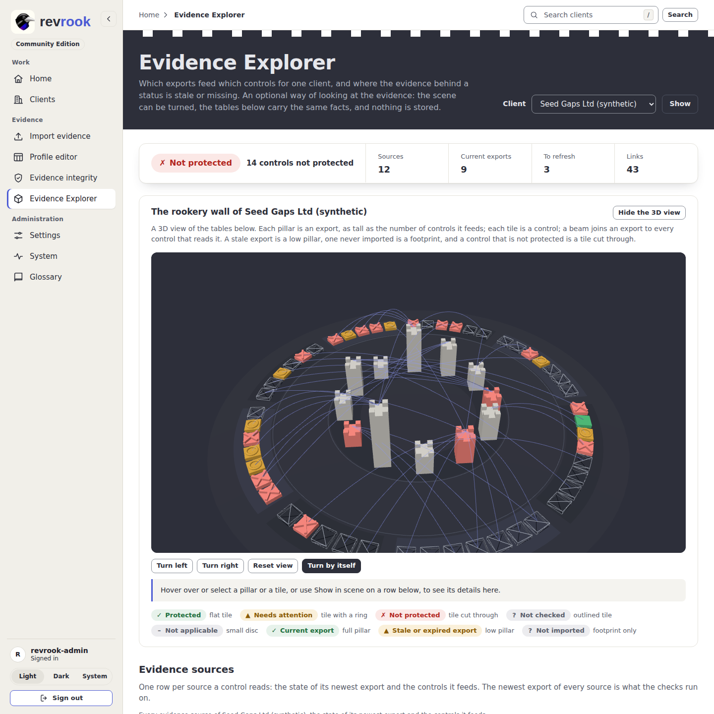

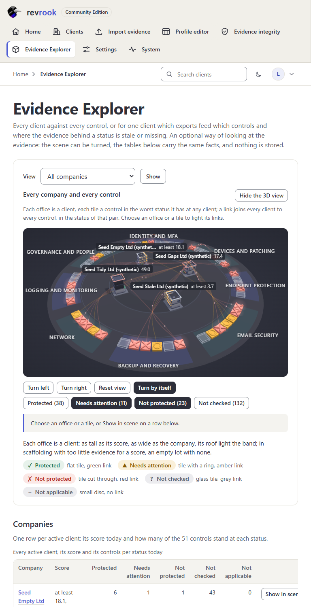

### The evidence wall of one client

1. Choose the client under **View** and press **Show**.
2. The verdict band gives the status that needs the most work, with the sources, the
   current exports, the exports to refresh and the links between sources and controls.
3. **The evidence wall** opens with **Show the 3D view** in the head of its card (the
   same choice as the scenes of Home and the client overview): an inner ring of office
   blocks, one per evidence source, as tall as the number of controls it feeds, its roof
   light the state of its newest export (an empty lot when it was never imported); an
   outer ring of tiles, one per control, grouped by domain; a faint beam from a source to
   every control that reads it. The public DNS check is a block of its own, joined to
   the three mail controls. The legend under the buttons names every shape.
4. Hover over a block or a tile to name it; select it to light its beams. A drag,
   **Turn left**, **Turn right** and **Reset view** turn the wall; **Turn by itself**
   lets it turn slowly until you touch it (not under reduced motion).
5. Under the scene, **Evidence sources** and the table of the controls carry the same
   facts as text; **Show in scene** on a row turns the wall to that source or control.

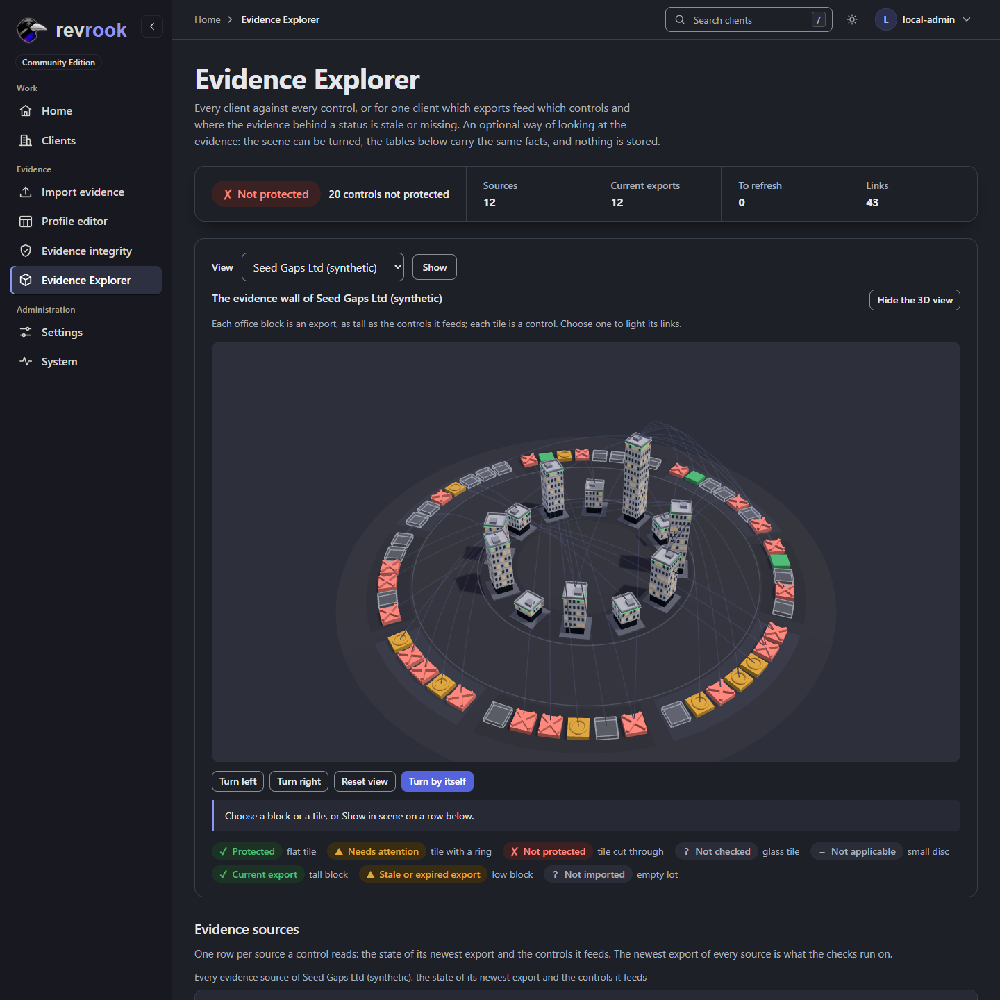

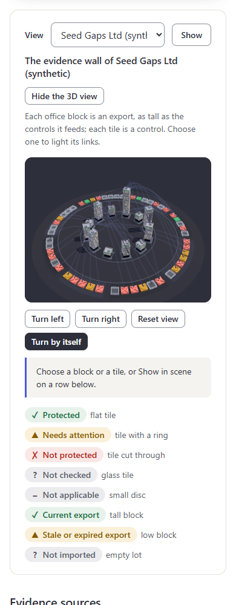

## Known limits

- The scenes were checked in a headless Chrome with a software renderer on the
  Development site, and the pictures of this guide were taken there in a headless Chrome
  with a hardware GPU; no phone or touch screen has been measured.

Back to the [guides](README.md).
