# 8. Scenes, the folded rail and the Evidence Explorer

Three pages carry a scene drawn in the browser: the rookery skyline on **Home**, the
domain keep on the overview of a client, and the rookery wall of the **Evidence
Explorer**. Each scene draws facts the page already shows: the cards, the bars and the
tables under it stay the record, and a scene adds nothing to a report. How the scenes
are built is in the [design system](../design-system.md#scenes).

A scene needs script and a browser with WebGL 2. Without them the page is the cards,
the bars and the tables, with no empty box where the scene would be. Nothing in the
rookery or the keep turns by itself, and when the system asks for reduced motion every
move is immediate.

## The rookery on Home

Under **Posture by client**, one rook per client stands on a charcoal yard, as tall as
its score and crenellated like the revrook mark. A strong or good band is stone, fair
is amber, weak or critical is red. A wire rook means the evidence is too thin for a
score (the dashed ring of its card), a flat footprint means nothing is imported yet,
and every notch at the foot of a rook is a control that needs work.

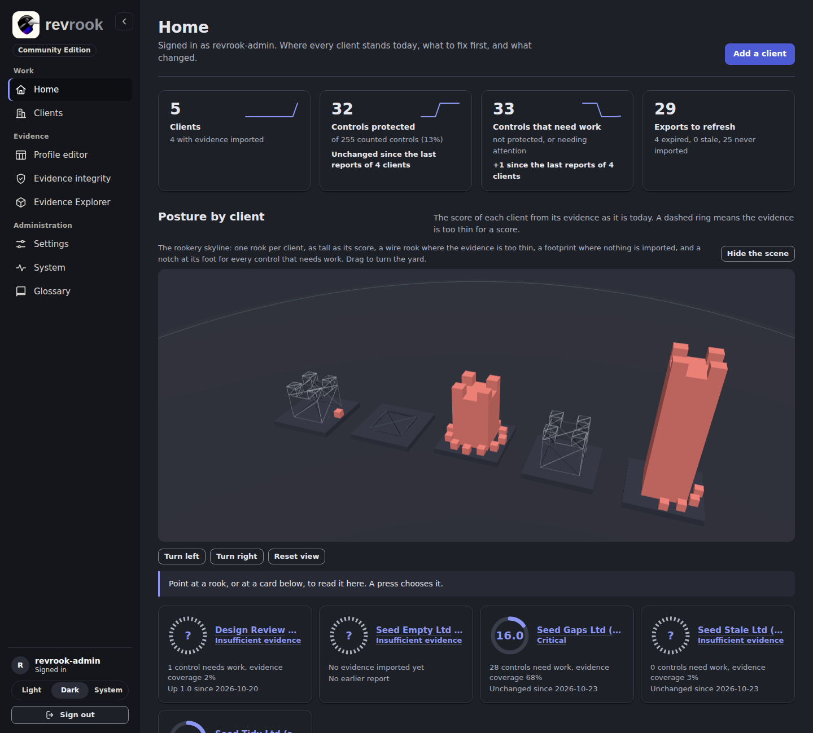

1. Point at a rook, or at its card, to read its name in the line under the stage.
2. Press a rook to choose it: the others step back, its card gets the violet mark at
   its left edge, and the detail line under the buttons names the client, its score,
   its band and how many controls need work.
3. Or work from the keyboard: press Tab until the stage has focus, then **Left** and
   **Right** to choose the next client, **[** and **]** to turn the yard, **+** and
   **-** to move closer and away, **Home** to reset the view, **Enter** to open the
   chosen client and **Escape** to clear the choice.
4. **Turn left**, **Turn right** and **Reset view** under the stage do the same with the
   mouse or a touch; a drag turns and tilts the yard.

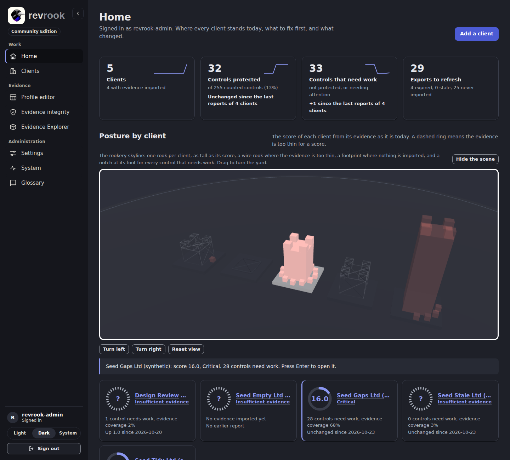

On a tablet the stage spans the page and the cards stand two to a row; on a phone the
row of rooks is fitted to the width of the stage, so each rook is small.

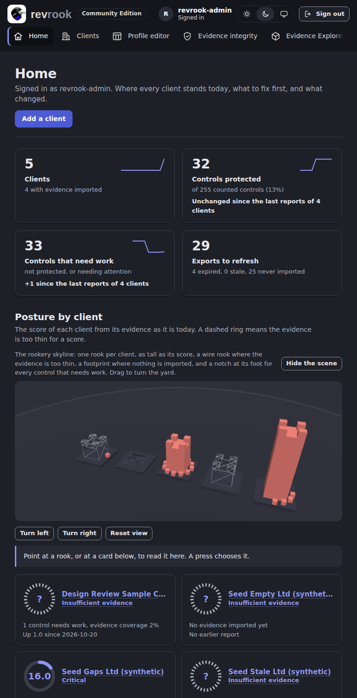

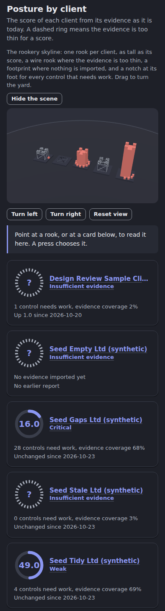

## The domain keep on a client overview

In **Coverage by domain** of a client overview, one block stands for each domain of the
control library, as wide as its weight in the score and built of its controls in
layers: protected at the foot, then needs attention, then not protected, and not
checked as wire, in the colours of the bars under it. A heavy domain with red layers
stands out at once.

1. Point at a block, or at its bar, to read it in the line under the stage.
2. Press a block, or focus the stage and press **Left** or **Right**, to choose a
   domain: the detail line names its protected controls, its weight and its score, and
   its bar gets a line in the margin of the card.
3. **Enter** opens the checklist narrowed to that domain, the same link the bar
   carries. The other keys work as on Home.

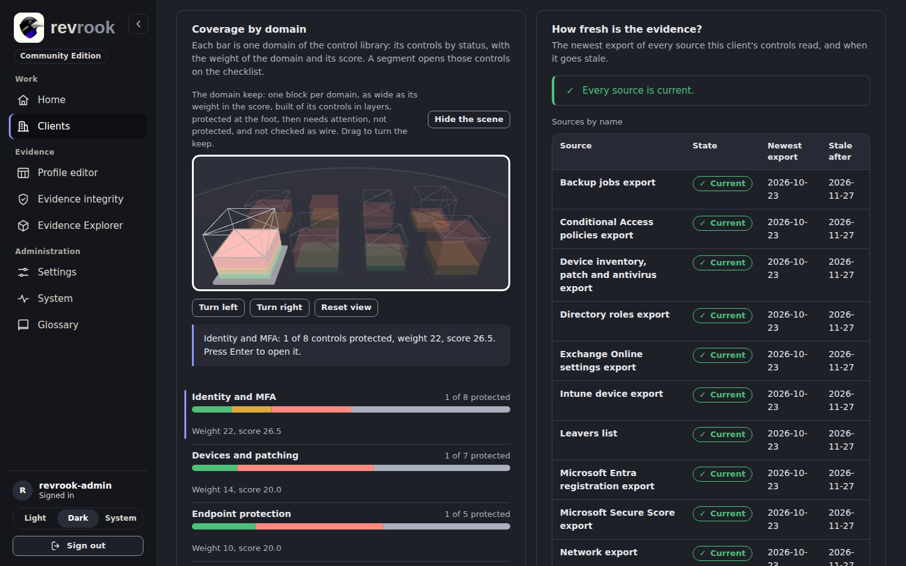

From 768 px down the card spans the page and the keep has more room.

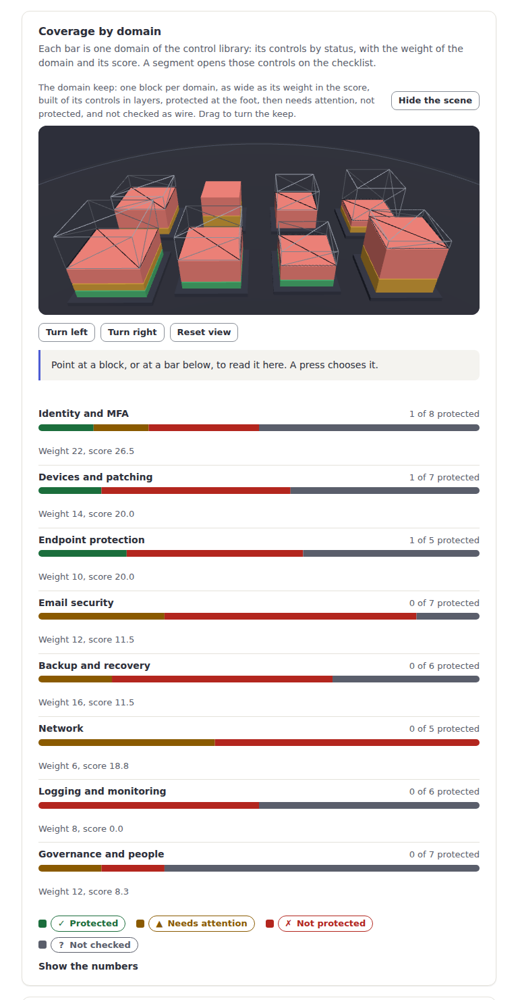

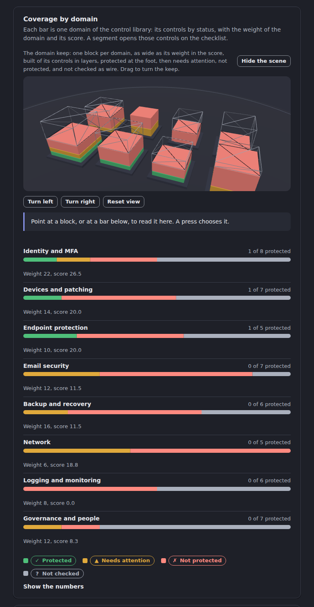

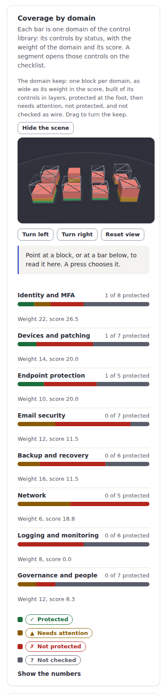

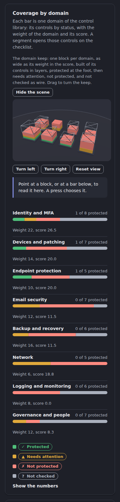

## Hide or show the scenes

The button above a stage, **Hide the scene**, puts the scenes away in this browser: the
stage, its buttons and its detail line go, and the cards and the bars stay where they
were. The button then reads **Show the scene** and brings them back. The choice is
kept in this browser only (another browser, or another person, still sees the scenes).

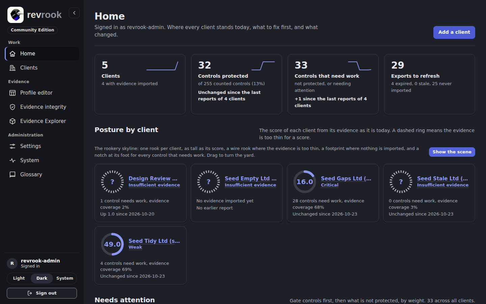

## Fold the rail

From 1024 px the navigation is a rail on the left. The button with the arrow at its
top, **Fold the rail**, folds it to a 72 px column of icons, so a wide table, a chart
or a scene gets the room. Point at an icon, or reach it with Tab, to read its name as
a tooltip; the current page keeps its mark. The same button, now **Open the rail**,
opens it again. The choice is remembered in this browser, so the next page is drawn
folded or open from the start. Below 1024 px the navigation is a bar at the top and
the button is not shown.

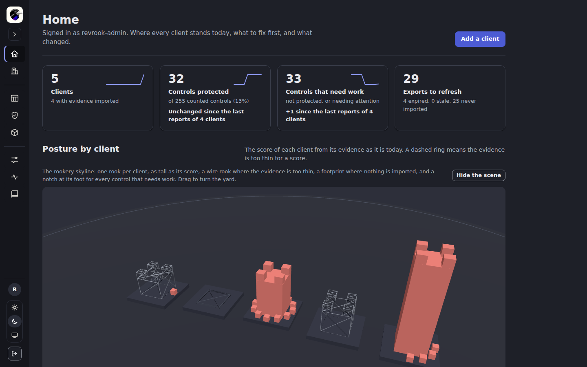

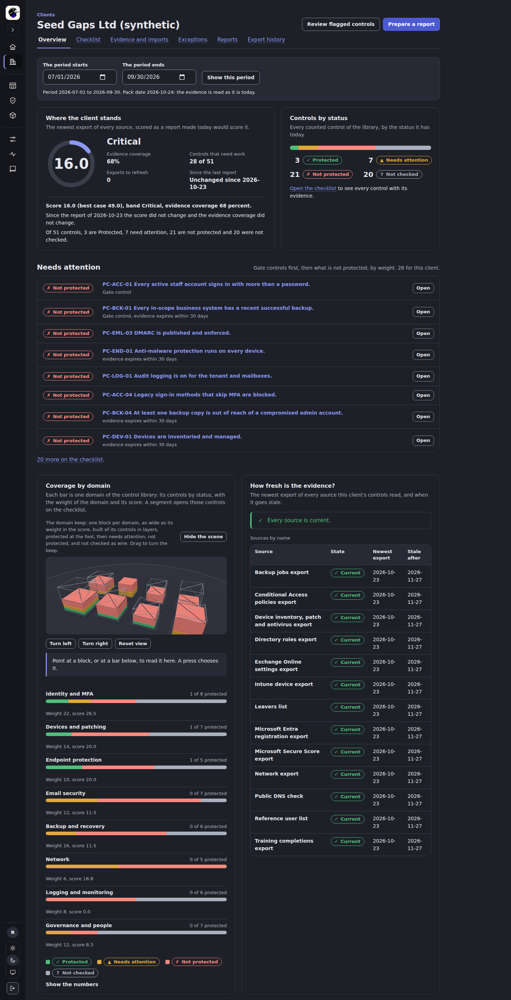

## Light, dark or the choice of the system

The three buttons under your name in the rail (in the bar on a tablet or a phone, as
icons) choose the theme: **Light**, **Dark**, or **System** to follow the setting of the
device. The choice is kept with your account (and in a cookie for the sign-in page),
so it follows you to another browser. The ground of every scene is the
same charcoal in both themes; the pictures of this guide show both.

## The Evidence Explorer

Open **Evidence Explorer** in the Evidence group. It shows, for one client, which
evidence exports feed which controls, and where the evidence behind a status is stale
or missing ([evidence-explorer-preview.md](../evidence-explorer-preview.md)).

1. Choose the **Client** and press **Show**.
2. The verdict band gives the status that needs the most work, with the sources, the
   current exports, the exports to refresh and the links between sources and controls.
3. **The rookery wall**: an inner ring of pillars, one per evidence source, as tall as
   the number of controls it feeds; an outer ring of tiles, one per control, grouped by
   domain; a beam from a source to every control that reads it. The legend under the
   buttons names every shape.
4. Point at a pillar or a tile to name it; press it to bring its beams forward. A drag,
   **Turn left**, **Turn right** and **Reset view** turn the wall; **Turn by itself**
   lets it turn slowly until you touch it (not under reduced motion).
5. Under the scene, **Evidence sources** and the table of the controls carry the same
   facts as text; **Show in scene** on a row turns the wall to that source or control.

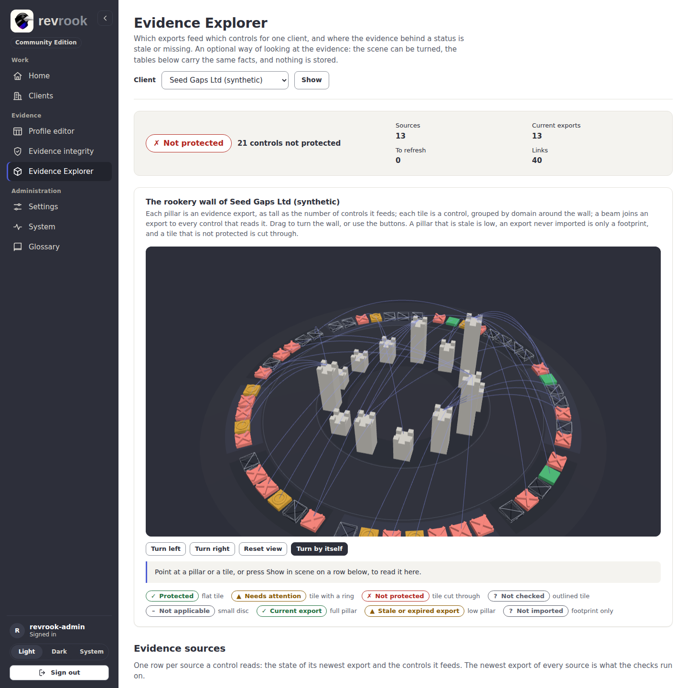

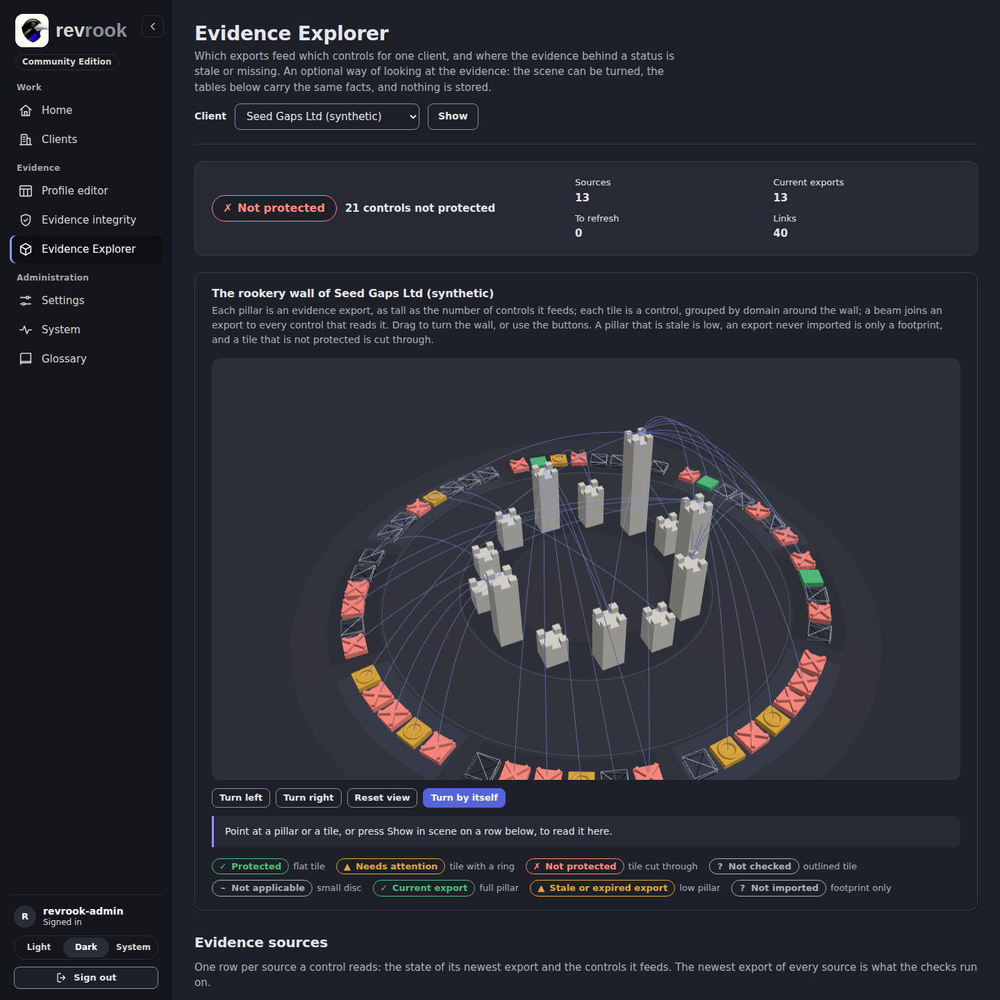

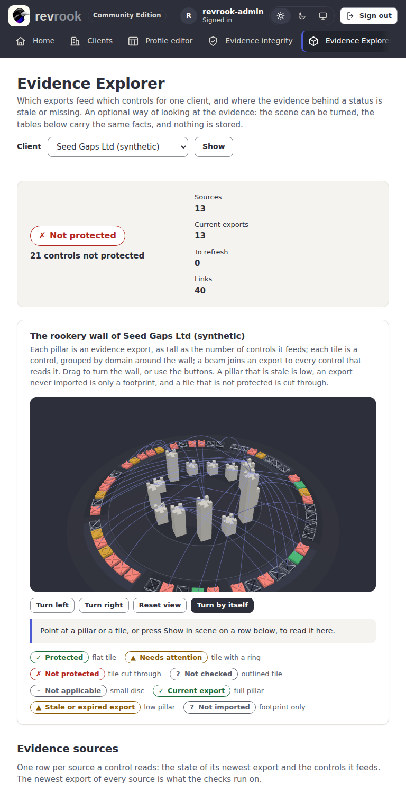

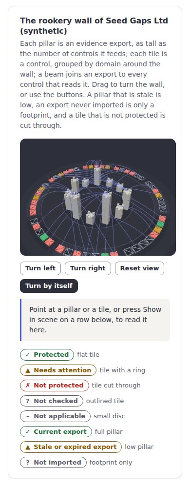

## Known limits

- At 768 px the keep can draw the block in the front right corner past the bottom edge
  of its stage, depending on the angle; the bar of that domain under the stage is not
  affected ([the picture at 768 px in the dark theme](../images/client-overview-768-keep-dark.png)).
- The scenes were checked in a headless Chrome with a software renderer on the
  Development site; no hardware GPU, phone or touch screen has been measured.

Back to the [guides](README.md).
