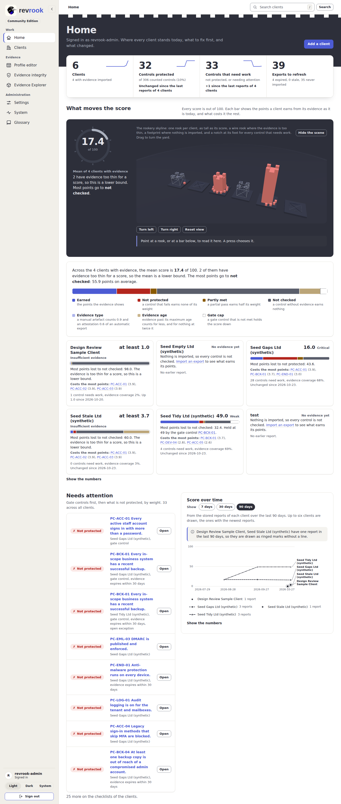
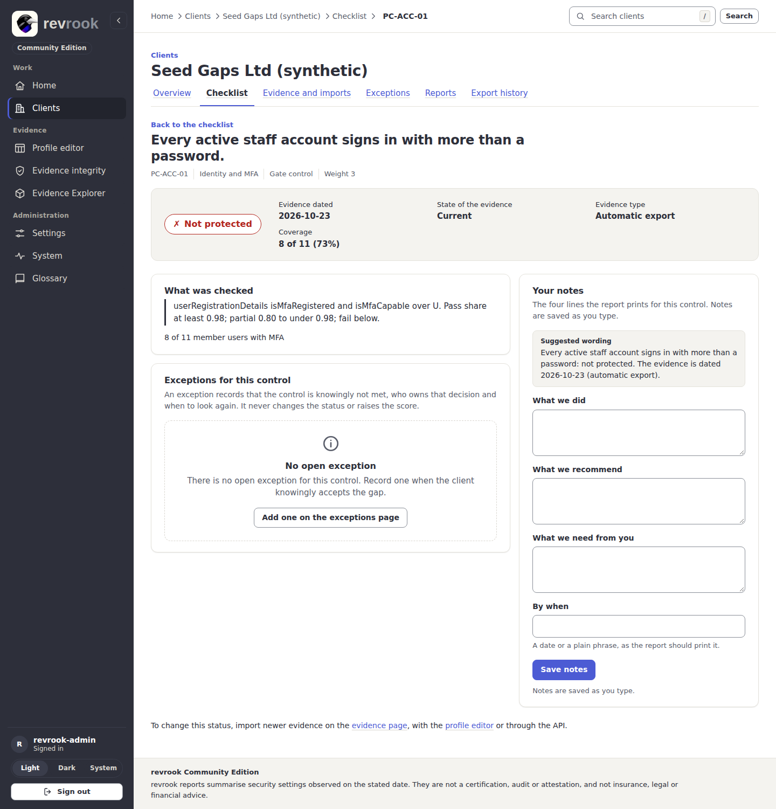
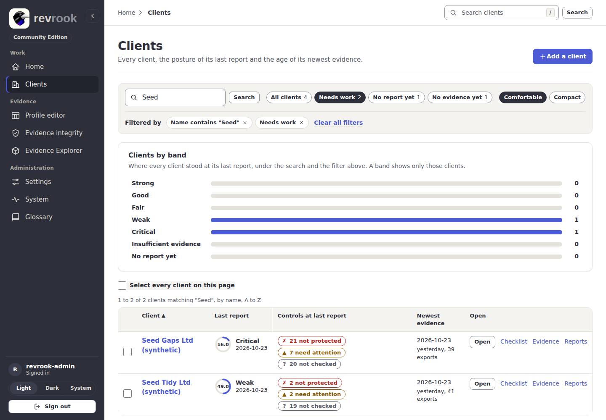
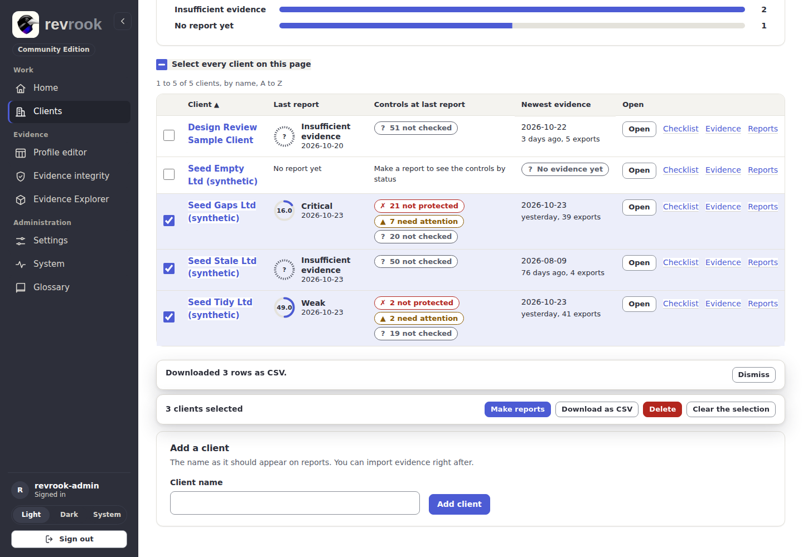
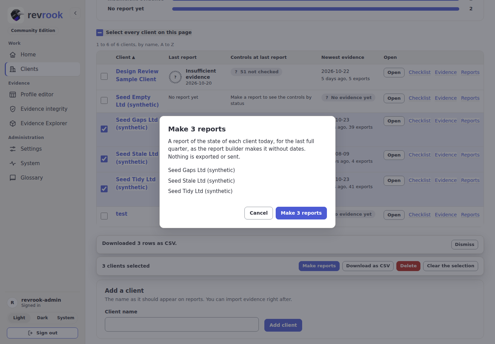
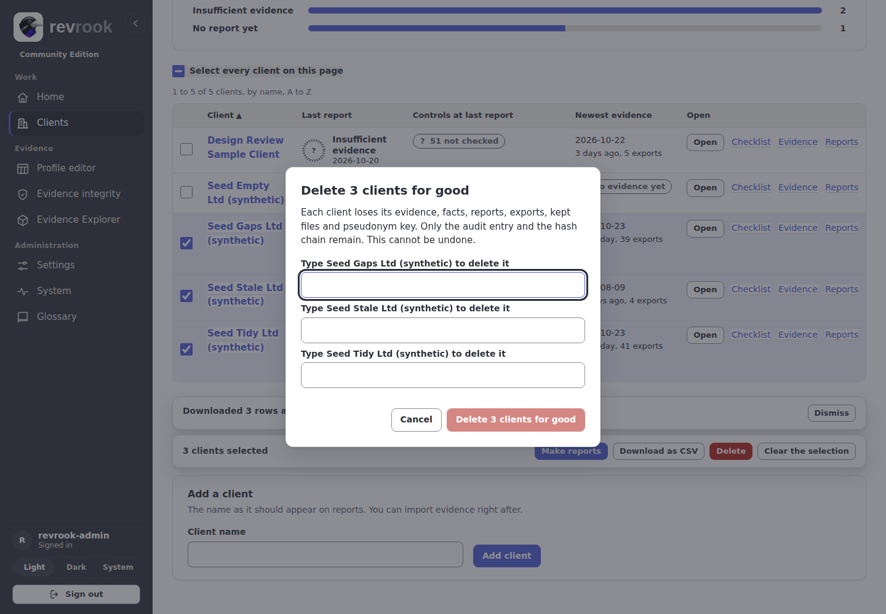
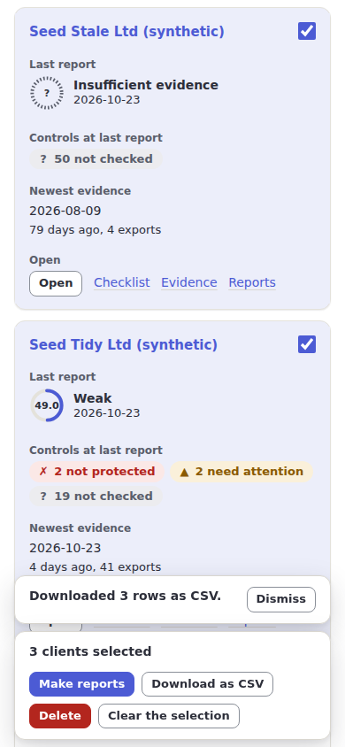

# 9. The top bar, the filters in use and bulk actions

Three tools for working across clients: the top bar of every signed-in page, the chips
that show and remove the filters of the clients list, and the bulk actions that make a
report for, download or delete several clients at once. Each works without script; the
script adds the keyboard shortcut, the focus moves and the selection. How they are built
is in the [design system](../design-system.md#the-shell).

## The top bar

Every signed-in page opens with the top bar, above the page header.

- **The breadcrumb** on the left says where you are: Home alone on Home; Home and the
  place in the rail on the other pages; on a page of one client, Home, Clients, the
  client, its tab and, deeper, the control or the report. Every step but the last is a
  link; the last is the page you are on.
- **Search clients** on the right searches the clients by name and opens the clients
  list with what you typed. From anywhere outside a field, press **/** to put the
  cursor in it (from 1024 px the key is shown inside the field), type part of a name and
  press Enter or **Search**.
- Below 768 px the search takes its own row under the breadcrumb, and a long client
  name wraps instead of being cut.

## The filters in use on the clients list

A search, a filter chip (**Needs work**, **No report yet**, **No evidence yet**) or a band
of **Clients by band** narrows the list. Each one in use is shown under **Filtered by**
as a chip with a cross:

1. Search from the top bar or the list, for example `Seed`: the chip reads
   **Name contains "Seed"**.
2. Press **Needs work**: a second chip, **Needs work**, joins it, and **Clear all
   filters** appears beside them.
3. Press a chip, or give it focus and press **Delete** or **Backspace**, to remove that
   filter only. The list loads again without it, the focus moves to the next chip (or,
   when none is left, to the **Show** chips) and a screen reader hears what was removed
   and how many clients are shown.
4. **Clear all filters** removes them all at once.

## Bulk actions on the clients list

With script, every row of the clients list has a select box labelled with the client
name, and **Select every client on this page** above the table chooses or clears the
whole page (it shows a mixed state when only some rows are chosen). A chosen row is
tinted as well as ticked. Below 1024 px the box sits in the top corner of each card.

As soon as one client is chosen, a bar sticks to the foot of the window with the count
in words and four buttons. Every action is one the application already has, run one
client after another, so a refusal for one client never stops the others; the result
is a card above the bar that stays until **Dismiss** or the next action.

### Download the chosen rows as CSV

Press **Download as CSV**. The browser saves `revrook-clients-<date>.csv` with one row
per chosen client: the name, the score, the band and the date of the last report, the
date of the newest evidence and the number of exports. The file is made in the browser
from the rows on the page; nothing is sent to the server. The result card says how many
rows were downloaded.

### Make a report for each chosen client

1. Press **Make reports**. A dialog names every chosen client and says what will
   happen: a report of the state of each client today, for the last full quarter, as
   the report builder makes it without dates. Nothing is exported or sent.
2. Press **Make reports** in the dialog to go on, or **Cancel** (or Escape) to leave
   everything as it was; the focus goes back to the button you pressed.
3. The result card lists each client with what happened and a link to each new
   report, to preview and export it from its own page
   ([6. Reports and exports](06-reports-and-exports.md)).

### Delete the chosen clients

Deleting a client cannot be undone: it loses its evidence, facts, reports, exports,
kept files and pseudonym key, and only the audit entry and the hash chain remain. As on
the System page, you type the name of every client you delete.

1. Choose at most ten clients and press **Delete**.
2. The dialog has one field per client, **Type** *name* **to delete it** (for
   example "Type Seed Tidy Ltd (synthetic) to delete it"). Type each name exactly as
   it is shown. The red button stays disabled until every name matches;
   then Enter or the button confirms. **Cancel** or Escape leaves everything as it was.
3. The server checks each name again and deletes the clients one after another. The
   result card names each deleted client, says that the counts drawn above still
   include them, and has **Load the list again**.

No client was deleted for the pictures of this guide: the dialog was closed with
**Cancel**.

### On a phone

The rows are cards with the select box in their top corner, and the bar stands at the
foot of the screen with its buttons wrapping under the count.

Back to the [guides](README.md).
