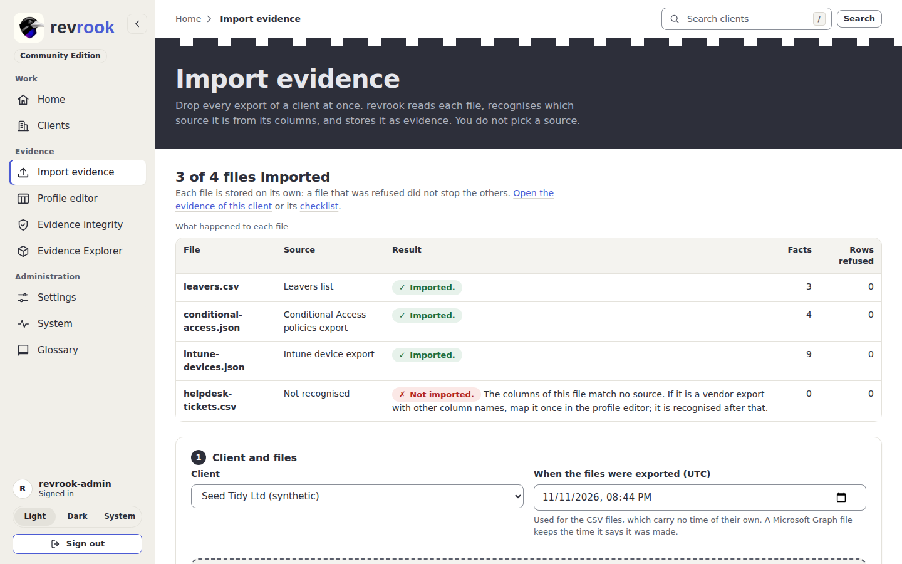

# 10. Export Microsoft 365 with the script

Six of the sources revrook reads come from one Microsoft 365 tenant: the Entra
registration report, the Secure Score, the Intune devices, the Conditional Access
policies, the directory roles and the Exchange Online settings. Instead of exporting
each by hand, one read-only PowerShell run writes all six files into a folder, ready
to drop on **Import evidence** ([3. Import evidence](03-import-evidence.md)). What
each file holds and which controls read it is in
[importers](../importers.md#the-five-microsoft-sources).

The script is `app/static/scripts/export-m365.ps1` in the repository, and every
installation serves it at `/static/scripts/export-m365.ps1`; the link **download the
export script** on Import evidence points there.

## What you need

- PowerShell 7 (or Windows PowerShell 5.1) on your own machine, with the modules
  `Microsoft.Graph.Authentication` and `ExchangeOnlineManagement`:

  ```powershell
  Install-Module Microsoft.Graph.Authentication, ExchangeOnlineManagement -Scope CurrentUser
  ```

- An account of the client tenant that can read it. The Graph scopes the script asks
  for are read-only: `AuditLog.Read.All`, `SecurityEvents.Read.All`,
  `DeviceManagementManagedDevices.Read.All`, `Policy.Read.All` and
  `RoleManagement.Read.Directory`. Exchange needs a role that can read the organisation
  settings (View-Only Organization Management, or Global Reader). The protection alerts
  come from Security & Compliance PowerShell; leave them out with `-SkipAlerts` when
  that is not available.

Nothing in the tenant is changed. The script signs in with your own account in the
browser window PowerShell opens; no password, token or secret is written anywhere.

## Run it, in four steps

1. Open **Import evidence** and press **download the export script**. A downloaded
   script may need `Unblock-File ./export-m365.ps1` before PowerShell runs it.
2. Run it with the folder to write into, and the tenant when it is not your own:

   ```powershell
   ./export-m365.ps1 -OutputFolder ./contoso-2026-11 -TenantId contoso.onmicrosoft.com
   ```

   `-SkipExchange` writes only the five Graph files; `-SkipAlerts` leaves the
   protection alerts out of the Exchange file. Add `-UseDeviceCode` when no sign-in
   window appears (Windows opens it through its account manager, which an embedded
   terminal, a remote session or a server may not show): each sign-in then prints a
   short code to enter at https://microsoft.com/devicelogin in any browser.
   A tenant may block sign-in by code (Microsoft answers with error 530035, as a
   Conditional Access or security-defaults rule); then run the script without the
   switch in a normal PowerShell window, where the sign-in window does appear.
3. Sign in when Microsoft Graph asks, and again when Exchange Online asks. The script
   prints each file with the number of records it holds, then `Done`.
4. Open **Import evidence**, choose the client and drop the whole folder on the import
   area (or choose the six files). Each file is recognised by its content; the five
   JSON files keep the time they were made (`capturedAt`), so their evidence is dated
   correctly, and the Exchange CSV takes the time of the form.



## What is written

| File | Read from | Holds |
| --- | --- | --- |
| `entra-registration.json` | Graph `reports/authenticationMethods/userRegistrationDetails` | who has registered MFA and which methods |
| `secure-score.json` | Graph `security/secureScores` | the newest Secure Score reading |
| `intune-devices.json` | Graph `deviceManagement/managedDevices` | the managed devices, with their compliance, encryption and operating system; the fields are selected, so no serial number, IMEI or phone number is written |
| `conditional-access.json` | Graph `identity/conditionalAccess/policies` | the Conditional Access policies and their state |
| `directory-roles.json` | Graph `directoryRoles` with their members | the directory roles and who holds them |
| `exchange-export.csv` | Exchange Online | DKIM signing per domain, the outbound and transport settings, the mailboxes by their directory id, the audit configuration and the protection alerts |

A tenant with nothing to report in one of them (no Conditional Access policy, for
example) still gets its file, with an empty `value`; Import evidence recognises it by
its `@odata.context` and stores it, so the control reads that the tenant has none.

## Privacy

The script reads the tenant and writes the files on your machine only; revrook never
connects to Microsoft 365 itself. The files hold identifiers of users, devices and
mailboxes, which revrook stores as the client's pseudonyms, never as the original
values; the Intune export leaves serial numbers, IMEIs and phone numbers out before
the file is written. Keep the folder where your own policy keeps client exports, and
delete it once imported: revrook keeps what it needs under the retention of the
installation ([operations](../operations.md)).

Next: [11. The public DNS check](11-public-dns-check.md).
