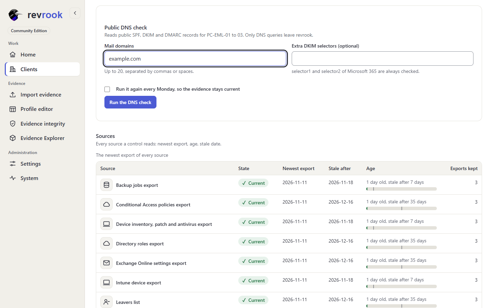
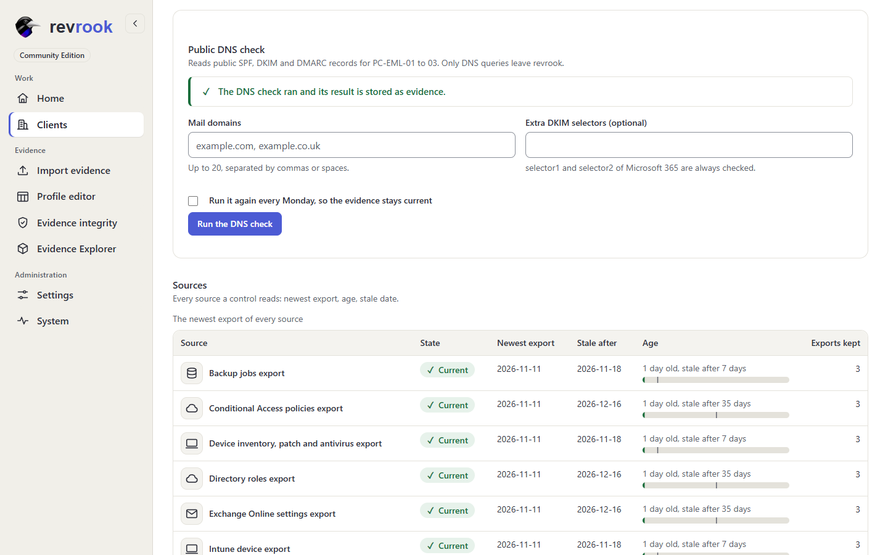

# 11. The public DNS check

Three controls read the public mail records of a client's domains: `PC-EML-01` (an
SPF policy), `PC-EML-02` (DKIM signing, together with the Exchange export) and
`PC-EML-03` (a DMARC policy). Nobody exports those: revrook looks them up itself, from
the evidence page of the client, and stores the answer as evidence like any other
source. What is looked up, what leaves the installation and how a record is read is in
[dns-check](../dns-check.md).

## Run it once

1. Open the client and its tab **Evidence and imports**, and scroll to the card
   **Public DNS check** (under **Refresh these exports**).
2. Type the **Mail domains** of the client, up to 20, separated by commas or spaces.
3. **Extra DKIM selectors** is optional: `selector1` and `selector2` of Microsoft 365
   are always asked; add the selectors of another mail provider here.
4. Press **Run the DNS check**.

The check runs while the page waits (a run asks at most 400 DNS questions and takes at
most a minute, five seconds per lookup), then the page comes back with **The DNS check
ran and its result is stored as evidence**. In the **Sources** table, **Public DNS
check** is now current with today's date; in **Everything imported** the run is one
more item of the source `dns-check`, in the hash chain of the client.

Only DNS questions about the entered names leave revrook: the domain, `_dmarc.` and
the `_domainkey` names of the selectors, and the `include:` and `redirect=` targets the
SPF record itself names. No client name, pseudonym, file or score is ever in a
question, and the domain is stored as the client's pseudonym.

## Keep it current every Monday

The DNS evidence goes stale after 35 days like any export. Tick **Run it again every
Monday, so the evidence stays current** before pressing the button: the run happens
now, and a `dns-check` schedule of the worker runs it again every Monday at 05:00 UTC
with the same domains and selectors. The schedule appears on the **System** page with
its last and next run ([7. Settings, System and the glossary](07-settings-system-and-glossary.md#system)),
and the message after the run says that it runs again every Monday.

To stop it, run the check again with the box unticked: the schedule is switched off
and the domains stay in the form for the next run. A client with no schedule yet has
the form empty; one that ran before has its domains filled in.

## Read the result

Open the checklist of the client, or the control itself, to read what the run found:
`PC-EML-01` counts the domains whose SPF passes, `PC-EML-02` needs DKIM signing in the
Exchange export and at least one selector record, and `PC-EML-03` takes the worst
DMARC state of the domains. A lookup that failed (a timeout, a resolver that does not
answer) is stored as unknown, never as a fail, so a bad run cannot turn a pass into a
fail; the newest run is the one that counts. The **Evidence Explorer** draws the DNS
check as a pillar of its own, joined to the three mail controls
([8. Scenes, the folded rail and the Evidence Explorer](08-scenes-rail-and-explorer.md#the-evidence-explorer)).

The same check runs through the API (`POST /api/v1/clients/{id}/dns-check`) and as a
schedule made through the API; the card is the same run, started from the page.

Back to the [guides](README.md).
